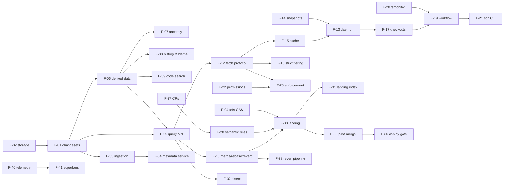

# 4. Feature list

Features are the user-visible capabilities we ship. Each one maps to the requirements it
satisfies ([03](03-requirements.md)) and to a release. Every **Must** requirement appears under
at least one feature (checked in [11](11-traceability.md)).

**Releases**
- **R1** Core version control and API
- **R2** Checkout architecture and client
- **R3** Security, review and landing
- **R4** Migration, automation and operations

## Feature catalogue

### Epic E1: version control core (R1)

| ID | Feature | What the user gets | Actors | Requirements | Pri |
|---|---|---|---|---|---|
| F-01 | Server-side changesets | Commits are created on the server, instantly visible everywhere; nothing to push | Developer, Agent | FR-CS-01…06, FR-CS-08, FR-CL-06 | M |
| F-02 | Content-addressed storage | Immutable compressed objects, integrity by id, no maintenance | all | FR-OBJ-01…05, FR-CS-03 | M |
| F-03 | Incremental commits | Commit cost tracks the change size, not the repository | Developer, Agent | FR-CS-09, NFR-05 | M |
| F-04 | Optional refs with compare-and-swap | Refs only where they are needed (main, releases), moved atomically and logged | Admin, landing service | FR-REF-01…04 | M |
| F-05 | Revision syntax | `main~3`, `abc123^2`, unique prefixes | all | FR-CS-07 | S |
| F-06 | Derived-data engine | One mechanism for every index (root trees included); eager or deferred; extensible; backfill | Admin, server | FR-DD-01…07 | M |
| F-07 | Fast ancestry | Merge bases and ancestor checks in O(log n) | CI, tools | FR-DD-10, FR-QRY-05, FR-QRY-09, NFR-06 | M |
| F-08 | History and blame | History of any path (following renames); line blame that credits the true author through merges | Developer, Agent, tools | FR-DD-08, FR-DD-09, FR-DD-11, FR-QRY-06, FR-QRY-07 | M |
| F-09 | Query API | changesets, log, diff, merge-base diff, file read, directory list | CI, tools, Agent | FR-QRY-01…04, FR-QRY-08, FR-QRY-10 | M |
| F-10 | Server-side merge, rebase, revert | Three-way operations on the server with structured conflicts | Developer, Agent, pipelines | FR-WR-02…04 | M |
| F-11 | Checkout-less writes | Commit (and optionally move a ref) through the API alone; upload limits | Agent, CI | FR-WR-01, FR-WR-05, FR-WR-06, FR-WR-07 | M |

### Epic E2: checkout architecture and client (R2)

| ID | Feature | What the user gets | Actors | Requirements | Pri |
|---|---|---|---|---|---|
| F-12 | Want-only fetch protocol | Fetch exactly the objects needed, resumably, from any tier | Client, tiers | FR-FP-01…07 | M |
| F-13 | Node daemon | One shared, bounded object store per node over a Unix socket | CI, Agent | FR-TIER-01, FR-TIER-02, FR-TIER-04, FR-CL-12 | M |
| F-14 | Snapshot warm start | New nodes start warm from a snapshot that is refreshed periodically | Operator | FR-TIER-03, FR-TIER-11, FR-AD-02 | M |
| F-15 | Regional cache | An in-memory cache that serves stored bytes, with single flight and failover | Operator | FR-TIER-05, FR-TIER-06, FR-TIER-08…10 | M |
| F-16 | Strict tiering | Each tier serves only the tier below it | Operator | FR-TIER-07, NFR-08 | M |
| F-17 | Full, sparse and virtual checkouts | Pay only for the directories you list, or the files you read | Developer, CI, Agent | FR-CL-01, FR-CL-09, FR-CL-10, FR-FP-04 | M |
| F-18 | Bounded client cache | The client's local cache never grows without bound | Developer | FR-CL-02 | M |
| F-19 | Working-copy workflow | status, add, rm, restore, diff, commit, update, rebase, stack | Developer, Agent | FR-CL-03, FR-CL-05…08 | M |
| F-20 | Filesystem monitor | Fast status through inotify, with a sync cookie | Developer | FR-CL-04 | M |
| F-21 | `scn` CLI | One ergonomic CLI for working-copy operations, queries, review and automation | all humans and agents | FR-CL-11, NFR-18 | M |

### Epic E3: security, review and landing (R3)

| ID | Feature | What the user gets | Actors | Requirements | Pri |
|---|---|---|---|---|---|
| F-22 | Repository and directory permissions | Read and write rules per repository and directory; groups; admins | Admin, Security | FR-IAM-01…03, FR-IAM-06 | M |
| F-23 | End-to-end read enforcement | Restricted content never leaks through queries, search, objects or caches | Security | FR-IAM-04, FR-IAM-05, FR-IAM-11, NFR-10 | M |
| F-24 | Authentication and delegation | Tokens; services act on behalf of users | Security, Operator | FR-IAM-07, FR-IAM-08 | M |
| F-25 | Protected refs | Only the landing service or release managers move protected refs | Admin | FR-REF-03, FR-REF-05 | M |
| F-26 | Policy re-indexing and audit | Apply policy changes to existing data; audit access-relevant events | Security | FR-IAM-09, FR-IAM-10 | S |
| F-27 | Change requests | CRs on bare changesets, revisions, comments, approvals | Developer, Reviewer | FR-RV-01…04 | M |
| F-28 | Semantic approval rules | docs, comment-only and logic classes; per-directory rules; owners | Reviewer, Owner, Admin | FR-RV-05…07 | M |
| F-29 | Review UI | Requirements, comments and diff on a web page | Reviewer | FR-RV-08, FR-RV-09 | M |
| F-30 | Lock-free landing | Server-side rebase plus ref CAS; group commit; no merge queue | Developer, Agent | FR-LD-01…04 | M |
| F-31 | Landing index | "When did this change land?" as a direct lookup | Tools, Agent | FR-LD-05 | M |
| F-32 | Reviewer notifications | Webhook when a review is requested | Reviewer | FR-RV-10 | C |

### Epic E4: migration, automation and operations (R4)

| ID | Feature | What the user gets | Actors | Requirements | Pri |
|---|---|---|---|---|---|
| F-33 | git ingestion | Streaming, ordered, incremental, verified import of git history | Migration engineer | FR-MG-01…05, FR-MG-07 | M |
| F-34 | Metadata service during migration | Query ingested git history through the API before cut-over | CI, tools | FR-MG-06 | S |
| F-35 | Post-merge testing | Worker queue, reusable checkout, results, automatic revert | Test runner | FR-LD-07, FR-PM-01…04 | M |
| F-36 | Deploy gate | Newest changeset that passed post-merge testing | Release manager | FR-PM-05 | M |
| F-37 | Automated bisect | Find a culprit through the API, without a clone | Pipeline, Agent | FR-AUT-01 | M |
| F-38 | Revert pipeline | Revert and land through the server's landing path | Pipeline | FR-AUT-02, FR-LD-06 | M |
| F-39 | Code search | Path search on a derived index; server-side content search; permission-filtered | Developer, Agent | FR-SR-01…04, FR-DD-12 | M |
| F-40 | Telemetry | Health, stats, hit rates and latency on every component | Operator | FR-OP-01, FR-OP-02 | M |
| F-41 | Superfans and alerts | Adaptive per-component anomaly detection (telemetry and logs), threshold alerts, chat webhook | Operator, Superfan | FR-OP-03…05, FR-OP-08 | S |
| F-42 | Rate limiting | Per-principal token buckets and concurrency caps; 429 with Retry-After | Operator | FR-OP-06 | M |
| F-43 | Admin toolkit | init, snapshot, derive, reindex-acl, set-ref, bench, backup and restore | Admin, Operator | FR-AD-01…06, FR-OP-07 | M |
| F-44 | Multi-repository hosting | Several repositories per deployment, each with its own policy | Admin | FR-IAM-02 | S |
| F-45 | Indexed content search | Trigram-indexed content search for the full monorepo | Developer, Agent | FR-SR-03 | S |

## Feature dependencies

