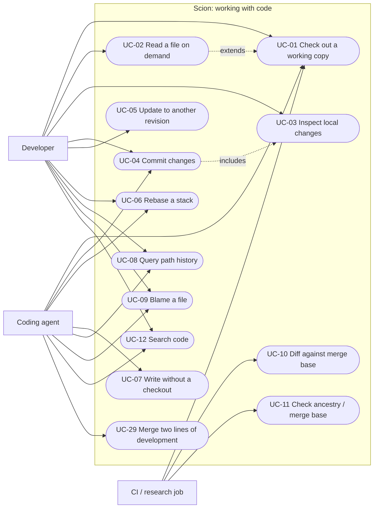
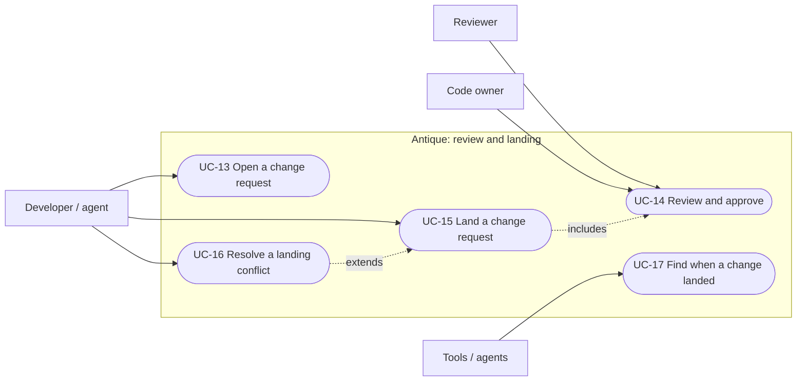
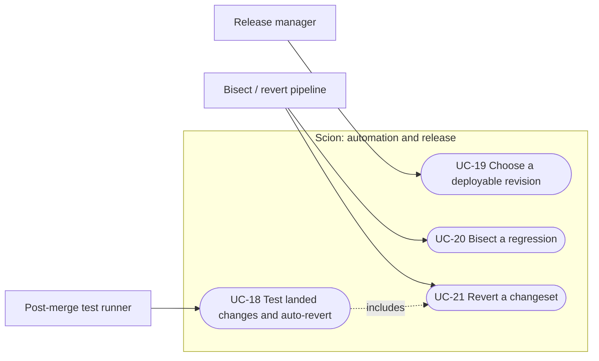
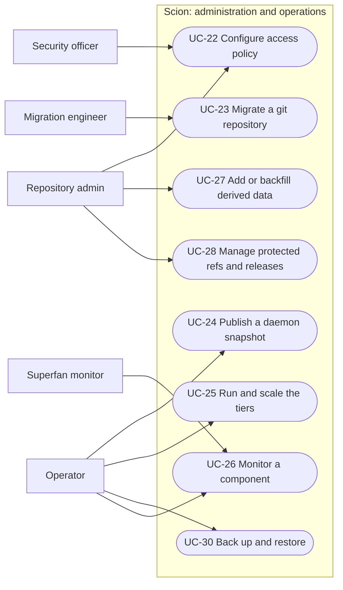

# 5. Use cases

## 5.1 Use case diagrams

Mermaid has no native use case diagram, so these use flowcharts: actors are rectangles,
use cases are rounded, and each subgraph is the system boundary.

### Working with code

### Review and landing

### Automation and release

### Administration and operations

## 5.2 Fully dressed use cases

Template: primary actor · level · requirements · preconditions · trigger · main success
scenario · extensions · postconditions · frequency.

---

### UC-01 Check out a working copy
* **Primary actor:** Developer, coding agent, CI job. **Level:** user goal.
* **Requirements:** FR-CL-01, FR-CL-02, FR-CL-03, FR-CL-09, FR-CL-12, FR-DD-07, FR-FP-01…07, FR-TIER-01…08, FR-IAM-04/05, FR-QRY-01.
* **Stakeholders:** CI infrastructure wants minimal fetch cost; security wants no restricted bytes on shared nodes.
* **Preconditions:** the node daemon is running; the actor is authenticated; the revision exists.
* **Trigger:** `scn clone <dest> [--sparse dirs | --virtual] [--rev R]`.
* **Main success scenario:**
  1. The actor asks for revision R in mode M (full, sparse with a directory list, or virtual).
  2. The client asks the server to resolve R to changeset C and root tree T.
  3. The client checks its local cache for T and asks the daemon for missing trees, one level at a time, descending only into directories the profile wants.
  4. The daemon serves hits from its node store. Misses go to the regional cache, and the cache's misses go to the server.
  5. The client asks for the missing blobs and writes each file with its kind (regular, executable, symlink), recording its state.
  6. The client reports the checked-out changeset and fetch statistics.
* **Extensions:**
  * 2a. R is unknown: `not_found`; the use case ends.
  * 3a. Mode is virtual: only the root tree is fetched. Files materialize on read (UC-02).
  * 3b. A tree under a directory the actor may not read comes back `denied`. The client asks the server for the permission-filtered listing and continues with the readable entries.
  * 4a. The cache is unreachable: the daemon fails over to another cache. If none answers, the operation fails and is retried.
  * 4b. An object fails integrity verification: it is rejected, not stored, and the operation fails.
  * 5a. The local cache reaches its bound: least-recently-used objects are evicted and the checkout continues.
  * \*a. Interrupted: running it again reuses objects already in the local cache and the daemon.
* **Postconditions:** the working copy is at C; the file-state database matches the disk; no restricted content was stored for an unauthorized actor or by a shared tier.
* **Frequency:** tens of millions per day, mostly CI.

### UC-02 Read a file on demand (virtual checkout)
* **Primary actor:** Developer, agent. **Level:** subfunction. **Requirements:** FR-CL-10, FR-FP-04, FR-QRY-08.
* **Preconditions:** a virtual working copy exists.
* **Trigger:** `scn cat <path>`, `scn materialize <path>`, or a program reading through the client API.
* **Main success scenario:**
  1. The actor asks for path P.
  2. The client walks the root tree to P, fetching only the trees on the path that are missing.
  3. The client fetches P's blob, writes the file and records it as materialized.
  4. The client returns the content.
* **Extensions:** 2a. P doesn't exist: `not found`. 2b. P is a directory: every file beneath it is materialized.
* **Postconditions:** exactly the files that were read exist on disk.

### UC-03 Inspect local changes
* **Primary actor:** Developer, agent. **Level:** user goal. **Requirements:** FR-CL-04, FR-CL-05.
* **Preconditions:** a working copy exists.
* **Trigger:** `scn status` or `scn diff`.
* **Main success scenario:**
  1. The client asks the filesystem monitor which paths changed since the last query, after a sync cookie confirms that all earlier events have been seen.
  2. The client checks only those paths plus previously dirty paths: size and mtime first, a content hash if they differ.
  3. The client reports modified, added, removed and untracked paths (and, for diff, a unified diff against the base content).
* **Extensions:**
  * 1a. No monitor is running, it restarted, or the kernel queue overflowed: the client does a full scan limited to the sparse profile.
  * 2a. Virtual mode, and a file appears at a never-materialized path: it is compared with the tree entry and reported as modified if it differs.
* **Postconditions:** cached stat data is refreshed for files that were touched but are unchanged.

### UC-04 Commit changes
* **Primary actor:** Developer, agent. **Level:** user goal. **Requirements:** FR-CL-06, FR-CS-01…09, FR-WR-06, FR-WR-07, FR-IAM-03.
* **Preconditions:** the working copy has local changes; the actor may write the paths.
* **Trigger:** `scn commit -m <message> [paths] [-A]`.
* **Main success scenario:**
  1. The client collects the changes (UC-03) and hashes the new contents.
  2. The client asks the server which blobs it lacks and uploads only those.
  3. The client asks the server to create a changeset with parent = the working copy's base.
  4. The server validates the paths and permissions, works out the operations relative to the first parent, builds the new tree incrementally, appends the changeset to the log, and computes eager derived data.
  5. The server returns the changeset id. The client moves its base to it.
* **Extensions:**
  * 1a. Nothing changed: `nothing to commit`.
  * 4a. The actor may not write a path: 403; nothing is created.
  * 4b. A file/directory collision: 400 with the reason.
  * 4c. Rate limited: 429; the client backs off and retries.
* **Postconditions:** the changeset is visible from every server; no ref moved; nothing needs pushing.

### UC-05 Update to another revision
* **Primary actor:** Developer, agent, CI job. **Level:** user goal. **Requirements:** FR-CL-07, FR-QRY-03.
* **Trigger:** `scn update <rev>`.
* **Main success scenario:**
  1. The client resolves the target and asks the server for the diff between base and target, limited to the sparse profile.
  2. The client checks that no local change touches a path in the diff.
  3. The client fetches the blobs for changed files, writes and deletes files, and moves its base.
* **Extensions:** 2a. Local changes overlap: refuse, listing the paths, unless `--clean`. 3a. Virtual mode: only materialized files are rewritten.
* **Postconditions:** the working copy is at the target; unrelated local edits are preserved.

### UC-06 Rebase a stack
* **Primary actor:** Developer, agent. **Level:** user goal. **Requirements:** FR-CL-08, FR-WR-03.
* **Trigger:** `scn rebase [--onto main]`.
* **Main success scenario:**
  1. The client asks the server to rebase head = its base onto the target.
  2. The server finds the merge base and replays each changeset in the stack with three-way merges, dropping any that are already applied.
  3. The server returns the new head and the old→new mapping. The client updates to the new head (UC-05).
* **Extensions:** 2a. Conflict: 409 with per-path reasons and the failing changeset; nothing changes. 2b. The stack contains a merge: refused.
* **Postconditions:** the stack sits on the target; the originals still exist.

### UC-07 Write without a checkout
* **Primary actor:** Agent, CI job. **Level:** user goal. **Requirements:** FR-WR-01, FR-WR-05, FR-WR-06, FR-WR-07.
* **Trigger:** API `create_changeset` (or `scn api commit`).
* **Main success scenario:**
  1. The actor sends the parent revision, the file contents (inline or uploaded beforehand), deletions and a message.
  2. The server creates the changeset as in UC-04 step 4.
  3. Optionally the server compare-and-swaps a ref to it and reports whether the ref moved.
* **Extensions:** 3a. The ref moved meanwhile: the changeset still exists, `ref_updated=false`; the actor retries or lands through Antique.

### UC-08 Query path history
* **Primary actor:** Developer, agent, tools. **Level:** user goal. **Requirements:** FR-QRY-06, FR-DD-08, FR-DD-11.
* **Trigger:** `scn history <path>` or the `file_history` API.
* **Main success scenario:**
  1. The server looks up the path in the history tree of the revision and gets the last changeset that changed it.
  2. It repeats from that changeset's first parent, following a recorded copy or rename to the source path.
  3. It returns `(changeset, path)` pairs, newest first.
* **Extensions:** 1a. Restricted path: 403. 2a. The path was a directory before it was a file (or the reverse): history stops at the change of kind.

### UC-09 Blame a file
* **Primary actor:** Developer, agent, tools. **Level:** user goal. **Requirements:** FR-QRY-07, FR-DD-09, FR-DD-03.
* **Trigger:** `scn blame <path>` or the `blame` API.
* **Main success scenario:**
  1. The server finds the changeset that last changed the file.
  2. If the deferred blame value is missing, the server derives it for that changeset and every ancestor still missing it, in topological order, and writes the values back.
  3. The server returns each line with its origin changeset, origin line number, and author.
* **Extensions:** 2a. Binary file: reported as binary. 1a. Restricted path: 403.
* **Postconditions:** blame values are stored, so the next query is a lookup.

### UC-10 Diff against the merge base (no checkout)
* **Primary actor:** CI job, tools. **Level:** user goal. **Requirements:** FR-QRY-04, FR-QRY-03, FR-QRY-05.
* **Trigger:** `diff(b=C, a=main, merge_base=true)`.
* **Main success scenario:**
  1. The server computes the merge base of C and `main` with generation numbers and skip lists.
  2. The server diffs the two root trees, skipping identical subtrees without reading them.
  3. The server returns the structured file list and, if asked, unified text.
* **Extensions:** 3a. Files the caller may not read are omitted.

### UC-11 Check ancestry or the merge base
* **Primary actor:** CI job, tools. **Level:** user goal. **Requirements:** FR-QRY-05, FR-QRY-09, FR-DD-10.
* **Trigger:** `is_ancestor`, `merge_base` or `fp_ancestor`.
* **Main success scenario:** the server answers with the generation-pruned walk, jumping through single-parent runs with skip lists in O(log n).

### UC-12 Search code
* **Primary actor:** Developer, agent. **Level:** user goal. **Requirements:** FR-SR-01…04, FR-DD-12.
* **Trigger:** `scn search <query>` or `scn grep <pattern> [path]`.
* **Main success scenario:**
  1. Path search: the server walks the search tree, descending only into directories whose bloom filter may contain the query's trigrams.
  2. Content search: the server scans the files under the prefix in parallel.
  3. Results are filtered by the caller's permissions and returned.
* **Extensions:** 2a. Too many matches: results are truncated and flagged.

### UC-13 Open a change request
* **Primary actor:** Developer, agent. **Level:** user goal. **Requirements:** FR-RV-01, FR-RV-10, FR-REF-01.
* **Trigger:** `scn review create --title …`.
* **Main success scenario:**
  1. The actor names a head changeset (by default the working copy's base) and a target ref.
  2. Antique records the CR with revision 1 and evaluates its requirements.
* **Extensions:** 1a. The head is already part of the target: refused.

### UC-14 Review and approve
* **Primary actor:** Reviewer, code owner. **Level:** user goal. **Requirements:** FR-RV-02…09, BR-01…03.
* **Main success scenario:**
  1. The reviewer opens the CR and sees the diff, the comments, and the requirements for each scope.
  2. Antique classifies each changed file as docs, comment-only or logic, and applies the most specific directory rule.
  3. The reviewer comments and approves the latest revision.
  4. Antique re-evaluates the requirements, counting owners' approvals separately and ignoring the author's own.
* **Extensions:** 3a. The author uploads a new revision: approvals reset (BR-02). 2a. Only docs or comment changes: requirements may already be satisfied with zero approvals.

### UC-15 Land a change request
* **Primary actor:** Developer, agent. **Level:** user goal. **Requirements:** FR-LD-01…05, FR-LD-07, FR-REF-02/03, NFR-01.
* **Preconditions:** the CR is open and its requirements are satisfied.
* **Trigger:** `scn review land <id>`.
* **Main success scenario:**
  1. Antique queues a landing request for the target on this server.
  2. The request holding the server's per-target leader slot drains the queue as one batch.
  3. It reads the target's tip T, then fast-forwards each request or rebases it onto the running head, in order.
  4. It compare-and-swaps the target from T to the final head.
  5. It indexes every landed changeset (landed id, original id, CR, ref, time), marks the CRs landed, and queues post-merge jobs.
* **Extensions:**
  * 3a. A request conflicts: that CR enters `conflict` with structured details, 409 goes to its author, and the rest of the batch continues.
  * 4a. The compare-and-swap fails because another server landed first: the batch is rebased onto the new tip and retried with jittered exponential backoff until a deadline.
  * 4b. The deadline passes: the requests fail as retryable.
  * 1a. Requirements are not met: 403 listing the unmet scopes.
* **Postconditions:** the target contains the change exactly once; the ref log shows one compare-and-swap per batch.

### UC-16 Resolve a landing conflict
* **Primary actor:** Developer, agent. **Level:** user goal. **Requirements:** FR-LD-04, FR-RV-02.
* **Main success scenario:** the actor rebases onto the target (UC-06), resolves the files, commits (UC-04), uploads the new revision, gets it re-approved (UC-14) and lands (UC-15).

### UC-17 Find when a change landed
* **Primary actor:** Tools, agents. **Level:** user goal. **Requirements:** FR-LD-05.
* **Main success scenario:** the actor asks with a landed or pre-rebase changeset id; Antique returns the landed id, CR, ref and time from its index.
* **Extensions:** the changeset never landed: `null`.

### UC-18 Test landed changes and revert automatically
* **Primary actor:** Post-merge test runner. **Level:** user goal. **Requirements:** FR-PM-01…04, FR-LD-06.
* **Main success scenario:**
  1. The runner claims the oldest queued job atomically.
  2. It updates its reusable checkout to the job's changeset (only the diff is fetched).
  3. It runs the test command and reports pass or fail with logs.
* **Extensions:** 3a. Failure with auto-revert enabled: the runner reverts every changeset of that landing, newest first, through the server's landing path (UC-21). The reverts are themselves queued for testing.

### UC-19 Choose a deployable revision
* **Primary actor:** Release manager. **Level:** user goal. **Requirements:** FR-PM-05.
* **Main success scenario:** the gate returns the newest changeset on the ref whose post-merge job passed; the release manager deploys it.
* **Extensions:** nothing has passed yet: `null`.

### UC-20 Bisect a regression
* **Primary actor:** Bisect pipeline, agent. **Level:** user goal. **Requirements:** FR-AUT-01, FR-QRY-01, FR-QRY-02.
* **Main success scenario:**
  1. The pipeline asks the server for the first-parent range from bad back to good.
  2. It probes midpoints with a predicate: API-only (file content) or a command in a reusable checkout.
  3. It returns the first bad changeset, its author, and the number of probes.
* **Extensions:** 1a. good isn't an ancestor of bad: error.

### UC-21 Revert a changeset
* **Primary actor:** Revert pipeline, developer. **Level:** user goal. **Requirements:** FR-WR-04, FR-AUT-02, FR-LD-06.
* **Main success scenario:** the server builds the revert on top of the current tip; the pipeline hands it to Antique's landing path, which rebases it if the tip moved and compare-and-swaps the ref.
* **Extensions:** the revert conflicts with later changes: 409; the pipeline escalates to a human.

### UC-22 Configure access policy
* **Primary actor:** Repository admin, security officer. **Level:** user goal. **Requirements:** FR-IAM-01…11, FR-AD-04.
* **Main success scenario:**
  1. The admin edits the policy (repository rules, directory rules, groups, protected refs, review rules, tokens, rate limits).
  2. The servers load the policy.
  3. The admin re-indexes ACLs so existing objects under newly restricted directories become restricted.
  4. The admin restarts or flushes the caches, which may still hold objects that were public before the change.
* **Extensions:** 3a. Re-indexing is skipped: existing objects stay readable by id (a documented risk, R-07).

### UC-23 Migrate a git repository
* **Primary actor:** Migration engineer. **Level:** user goal. **Requirements:** FR-MG-01…07, FR-AD-01.
* **Main success scenario:**
  1. The engineer runs ingestion for a git revision.
  2. Commits stream out in topological order. Each becomes a changeset of first-parent changes, with blobs streamed from one `cat-file` process.
  3. The ref is compare-and-swapped to the ingested tip.
  4. Verification compares every file with `git ls-tree`.
  5. The engineer re-runs ingestion periodically; only new commits are ingested.
* **Extensions:** 2a. A parent is missing (bad range or ordering): refused, nothing written. 2b. A submodule entry: skipped and counted. 4a. A mismatch: reported with paths; cut-over blocked.

### UC-24 Publish a daemon snapshot
* **Primary actor:** Operator (scheduled). **Level:** user goal. **Requirements:** FR-TIER-03, FR-TIER-11, FR-AD-02.
* **Main success scenario:** the operator snapshots a revision's public trees and blobs into blob storage and atomically updates `LATEST`; each daemon's refresh loop imports the new objects.
* **Extensions:** objects under restricted directories are never included.

### UC-25 Run and scale the tiers
* **Primary actor:** Operator. **Level:** user goal. **Requirements:** FR-TIER-04…10, FR-OP-06, FR-OP-07, NFR-07…09.
* **Main success scenario:** the operator starts more servers (stateless, shared storage), caches (pointed at several servers) or daemons (pointed at regional caches); tiering stays enforced; adding or removing an instance needs no data migration.
* **Extensions:** an upstream instance fails: callers fail over; single flight and rate limits protect the remaining instances.

### UC-26 Monitor a component
* **Primary actor:** Superfan monitor, operator. **Level:** user goal. **Requirements:** FR-OP-01…05.
* **Main success scenario:**
  1. The superfan polls one component's `/stats`.
  2. It turns counters into per-interval rates (including the interval hit rate) and updates an adaptive baseline for each metric.
  3. It raises "novel" findings for large deviations and "threshold" findings for configured rules.
  4. It posts findings to stdout and the chat webhook.
* **Extensions:** the component is unreachable: an "unreachable" finding.

### UC-27 Add or backfill derived data
* **Primary actor:** Repository admin, developer of Scion. **Level:** user goal. **Requirements:** FR-DD-01…06, FR-AD-03.
* **Main success scenario:** a new type is registered with a recursive `derive` function and an eager or deferred setting; for deferred types, the admin backfills ahead of demand; clients are unchanged.

### UC-28 Manage protected refs and releases
* **Primary actor:** Repository admin, release manager. **Level:** user goal. **Requirements:** FR-REF-02…05, FR-AD-05.
* **Main success scenario:** an authorized principal creates `release/x` at a changeset (or moves it) with a compare-and-swap; the move is logged.
* **Extensions:** an unauthorized principal: 403. The expected value is stale: CAS failure; re-read and retry.

### UC-29 Merge two lines of development
* **Primary actor:** Developer, agent, release manager (for example, merging a release branch back). **Level:** user goal. **Requirements:** FR-WR-02.
* **Trigger:** the `merge` API (`ours`, `theirs`).
* **Main success scenario:**
  1. The server computes the merge base.
  2. For every path that changed between the base and `theirs`, it applies a three-way merge onto `ours`.
  3. It creates a merge changeset whose change list is relative to `ours` (the first parent).
* **Extensions:** 2a. Conflicts: 409 with per-path reasons; nothing is created. 1a. `theirs` is already contained in `ours`: `ours` is returned unchanged.
* **Postconditions:** history and blame credit lines taken verbatim from `theirs` to their original changesets (BR-06).

### UC-30 Back up and restore
* **Primary actor:** Operator. **Level:** user goal. **Requirements:** FR-AD-06, NFR-13.
* **Main success scenario:**
  1. The operator takes a consistent backup of the metadata store and the blob storage.
  2. On disaster, the operator restores both and restarts the servers. Tiers rebuild their caches on demand.
* **Extensions:** blob storage is ahead of the metadata store: extra objects are harmless (nothing references them).
* **Postconditions:** refs and changesets are identical to the backup point.

## 5.3 Requirements realized by every use case

Some requirements are system qualities rather than goals of one actor, so they constrain every use case:

| Requirement | Why it has no single use case |
|---|---|
| FR-OBJ-01…05 | how every piece of data is stored and moved |
| FR-QRY-10 | every query in UC-08…12 and UC-20 is public API |
| FR-CL-11 | every developer-facing use case is reachable from `scn` |

