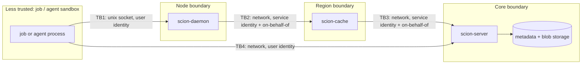

# 8. Security and threat model

## 8.1 Assets

The article puts it this way: managing safety, security and compliance in a massive monorepo is as
important as managing its size and scale, so Scion was built with them in mind from the start.

| Asset | Why it matters |
|---|---|
| Restricted source code (directories with read restrictions) | confidentiality, compliance |
| Integrity of `main` and release refs | what gets built and deployed |
| Review decisions (approvals) | the guarantee that humans saw consequential changes |
| Credentials (tokens) and service identities | everything else depends on them |
| Availability of the serving tiers | developer and CI throughput |

## 8.2 Trust boundaries

## 8.3 STRIDE analysis

| # | Threat | Boundary | Category | Mitigation | Requirements | Residual |
|---|---|---|---|---|---|---|
| S1 | A user claims to be another user | TB1, TB4 | Spoofing | bearer tokens per principal when configured (stored hashed if wanted); 401 otherwise | FR-IAM-07 | dev mode trusts headers; the daemon's Unix socket trusts the processes its file permissions admit (ADR-14). Tokens must be configured in production |
| S2 | A user claims to be a cache or daemon to skip checks | TB3 | Spoofing | the cache and daemon tiers require their service principals, proven by client certificates under mutual TLS; on-behalf-of only from service principals | FR-IAM-08, FR-TIER-07, NFR-20 | depends on the tiers' private keys staying secret |
| S3 | Forged author on a changeset | TB4 | Spoofing | the author defaults to the caller; only admins and services may set another | FR-CS-01 | — |
| T1 | Tampered object in a cache | TB2, TB3 | Tampering | ids are content hashes; the daemon and client verify every object | FR-OBJ-04 | — |
| T2 | Unauthorized move of `main` | TB4 | Tampering | protected refs; CAS; ref log | FR-REF-03/04 | — |
| T3 | Landing without the required approvals | TB4 | Tampering | requirements evaluated server-side at land time; self-approval excluded; approvals per revision | FR-RV-02/04/06, BR-01/02 | admins can force-land (audited, R-12) |
| T4 | Uploading crafted trees to bypass ACL indexing | TB4 | Tampering | clients may upload only blobs; trees are always derived on the server | FR-CS-01 | — |
| R1 | Denying having moved a ref | TB4 | Repudiation | ref log with actor and time | FR-REF-04 | the ref log is not tamper-evident (hash-chain later) |
| R2 | Unaudited policy changes or denials | — | Repudiation | audit trail | FR-IAM-10 | **gap** (see 11) |
| I1 | Reading restricted files through APIs | TB4 | Information disclosure | per-path checks on read_file, list_dir, blame, history, diff, grep, search, changeset listings | FR-IAM-04 | — |
| I2 | Reading restricted objects by id through caches | TB1–TB3 | Information disclosure | object ACL index; restricted flag; caches never store; server re-authorizes every request | FR-IAM-04/05 | objects public before a policy change remain cached until re-index and cache restart (R-07) |
| I3 | Restricted objects in daemon snapshots | — | Information disclosure | snapshots exclude restricted objects | FR-IAM-04 | — |
| I4 | Inferring restricted names from parent trees | TB1 | Information disclosure | parent tree objects list child names and ids | — | accepted: names of restricted directories are visible; their contents are not |
| I5 | Identical bytes at public and restricted paths | — | Information disclosure (false positive) | bytes seen at a public path are public | FR-IAM-11 | — |
| I6 | Traffic sniffing | TB2–TB4 | Information disclosure | TLS on every TCP hop; mutual TLS between tiers (ADR-14) | NFR-20 | plaintext remains possible for localhost development |
| D1 | API flooding by one principal | TB4 | Denial of service | token buckets per class; concurrency caps; 429 | FR-OP-06 | limits are per server process, not global |
| D2 | A cache outage stampeding the servers | TB3 | Denial of service | strict tiering, single flight, failover | FR-TIER-07/10, NFR-08 | — |
| D3 | Huge uploads | TB4 | Denial of service | request body cap (512 MB); per-file limit with bounded decompression, 413 (FR-WR-07) | FR-WR-07 | — |
| E1 | Using a service principal from a sandbox | TB1 | Elevation of privilege | service tokens kept off job nodes; the daemon authenticates upstream with its own identity | FR-IAM-08 | deployment discipline |
| E2 | Admin endpoints exposed to users | TB4 | Elevation of privilege | `derive`, `record_landing`, `land_changeset` and force-land require admin or service | FR-IAM-06 | — |

## 8.4 Security requirements carried into implementation

1. Tokens required in every non-development deployment (FR-IAM-07). Built in B2.
2. TLS/mTLS between all tiers before production (NFR-20). Built in B2 (ADR-14).
3. Audit log of policy changes, access denials and admin actions (FR-IAM-10). Planned for B3.
4. Re-index ACLs and restart caches as part of the policy-change procedure (UC-22). Planned for B3/B4.
5. A per-file size limit on uploads (R-10). Built in B2 (FR-WR-07).
