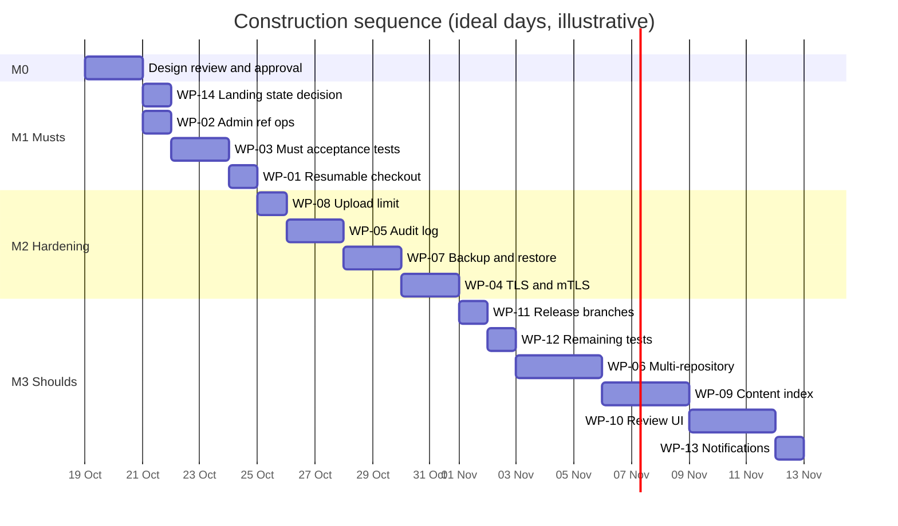

# 12. Project plan

## 12.1 Lifecycle

| Phase | Goal | Exit milestone | Status |
|---|---|---|---|
| Inception | vision, scope, stakeholders | M0a: 01–02 approved | awaiting review |
| Elaboration | requirements, use cases, UML, architecture, risks, test plan, traceability | **M0: design baseline approved** (01–13 signed off) | awaiting review |
| Construction | close the gap list, one traced work item at a time | M1–M3 | not started (code frozen until M0) |
| Transition | migration pilot, cut-over, operations | M4–M5 | not started |

> **Note on order.** A prototype was built before elaboration. Its code is treated as a spike:
> it is kept, but it is measured against this baseline (11) and changes only through the gap list
> below.

## 12.2 Work breakdown (remaining work)

Estimates are in ideal engineering days for one engineer working with an agent.

| WP | Gap / item | Work | Requirements | Estimate |
|---|---|---|---|---|
| WP-01 | GAP-01 | resumable checkout | FR-FP-03 | 1 |
| WP-02 | GAP-02 | admin ref operations with an explicit identity and protections | FR-AD-05 | 0.5 |
| WP-03 | GAP-03 | missing acceptance tests for Musts, plus the D-01 fix | FR-CS-09, FR-IAM-01, FR-MG-04, FR-PM-01 | 1.5 |
| WP-04 | GAP-04 | TLS/mTLS between tiers and for clients | NFR-20 | 2 |
| WP-05 | GAP-05 | audit log (policy, denials, admin actions) | FR-IAM-10 | 1.5 |
| WP-06 | GAP-06 | multi-repository hosting | FR-IAM-02 | 3 |
| WP-07 | GAP-07 | backup and restore | FR-AD-06 | 1.5 |
| WP-08 | GAP-08 | per-file upload limit | FR-WR-07 | 0.5 |
| WP-09 | GAP-09 | trigram content index (a derived type) | FR-SR-03 | 3 |
| WP-10 | GAP-10 | interactive review UI with inline comments | FR-RV-09 | 3 |
| WP-11 | GAP-11 | release-branch command and test | FR-REF-05 | 0.5 |
| WP-12 | GAP-12 | remaining test gaps | FR-DD-06, FR-IAM-09, FR-OP-05 | 1 |
| WP-13 | GAP-13 | reviewer notifications | FR-RV-10 | 1 |
| WP-14 | D-02 | decide: a `Landing` CR state, or amend the design | — | 0.5 |
| WP-15 | — | metadata-store adapter for a distributed database (Spanner) | R-02, NFR-07 | 10+ (needs infrastructure) |

## 12.3 Milestones

| Milestone | Contents | Exit criteria |
|---|---|---|
| **M0: design baseline** | documents 01–13 | approved by the project lead; open questions answered (12.7) |
| **M1: every Must complete** | WP-01, WP-02, WP-03, WP-14 | every Must requirement has status **I** in 11; full suite plus 32×5 stress green |
| **M2: production hardening** | WP-04, WP-05, WP-07, WP-08 | security requirements of 08 §8.4 closed; R-08 retired |
| **M3: Shoulds** | WP-06, WP-09, WP-10, WP-11, WP-12, WP-13 | every Should is **I**; docs check (T-DOC-01/02) green |
| **M4: migration pilot** | ingest a real repository; a metadata-only service for CI | verify reports zero mismatches; CI queries served from Scion |
| **M5: cut-over** | daemons on the nodes, caches per region, landing through Antique | git becomes read-only; success criteria of 01 §1.7 measured |

## 12.4 Definition of Ready (a work item may start when)

1. It references approved requirement IDs, and each has an acceptance criterion.
2. The use cases and diagrams affected are identified, or updated first.
3. The test cases are designed (IDs added to 10).
4. Risks and security impact are noted (08, 09).

## 12.5 Definition of Done

1. The code implements exactly the referenced requirements, nothing more.
2. New and updated automated tests pass, along with the full suite, the 32×5 stress simulation, and the docs checks (T-DOC-01 rendering, T-DOC-02 cross-references).
3. The traceability matrix (11) is updated: status, design element, tests.
4. User-facing docs are updated (README, API, FEATURES).
5. Committed with a message that names the work package and requirement IDs.

## 12.6 Change control

* **Requirement changes:** edit 03 with a new or changed ID; record why in the commit; update 04, 05 and 11 in the same change; T-DOC-02 must pass.
* **Architecture changes:** a new ADR row in 07 §7.11 (never edit an accepted ADR; supersede it).
* **Code changes without a work item:** not allowed after M0, except fixes for severity-1 defects, which get a work item retroactively within the day.

## 12.7 Open questions for the project lead (needed for M0)

1. **Scope.** Is the gap list's priority right? In particular, should multi-repository hosting (FR-IAM-02) be a Must?
2. **D-02.** Should a change request show a `Landing` state while it is queued (UI clarity), or should the design drop that state?
3. **Production intent.** Is this a reference implementation for study, or is M2 (hardening) in scope? This decides whether WP-04, WP-05 and WP-07 are needed at all.
4. **Code.** Should the prototype be kept as the construction baseline (recommended), or removed and rebuilt from this package?

## 12.8 Roles

| Role | Responsibility | Who |
|---|---|---|
| Project lead / product owner | approves the baseline, prioritizes the gap list | you |
| Architect / implementer | maintains the package; implements work items | Claude |
| Reviewer | reviews each work item against its requirements | you, or a delegate |
