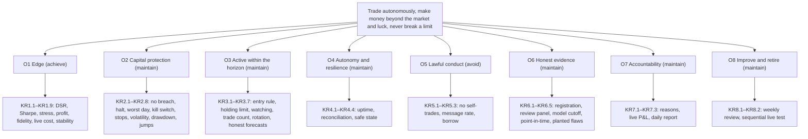

# The goal

**Version 4, 2026-10-15.** Version 3 was revised after the goal tests and an independent review
(`REPORT.md`). Version 4 settles the open decisions on researched evidence
(`../reports/Trading goal decisions research.md`) and on the owner's answers: no fixed number of
positions, and 120 days of paper trading. The decisions, with what the research found, are at the end;
the owner can still overturn any of them. The method behind the goal is in `METHOD.md`. Every number here comes from `goal.toml`, which the tests read. This document sets what
the system must achieve and how that will be judged. How it is built comes next, top-down.

## On one page

**Mission.** An autonomous system that trades liquid US stocks and ETFs, long and short, holding each
position from seconds up to five trading days. It makes money after every cost, earns a return beyond
what the market's moves and chance would give, and never breaks its risk limits. It proves this on
history it was not built on, then on a paper account, before any real money. Real money starts with a
fraction of the intended capital and grows only while the evidence holds.

| Objective | Headline key results |
|---|---|
| **O1 Edge** (achieve): money made after every cost, beyond the market, and not luck | on at least 2,400 days of history not used to build it: Deflated Sharpe Ratio ≥ 0.95 counting every variant (KR1.1), Sharpe ≥ 1.0, aiming for 1.5 (KR1.2), a profit (KR1.4), holding in both halves (KR1.9); on paper: a profit (KR1.7), the live system doing what the tested strategy does (KR1.5, KR1.6) |
| **O2 Capital protection** (maintain): every loss inside fixed limits | no order beyond a limit (KR2.1); halt at a 9% drawdown, so 10% is never reached (KR2.2, KR2.7); worst day 2.5% (KR2.3); kill switch 60 s (KR2.4); stops that work while the system is down (KR2.5) |
| **O3 Active within the horizon** (maintain): watching all session, trading when the gain pays | the universe evaluated every minute (KR3.3); every entry's expected gain at least twice its cost (KR3.1), and those gains not inflated (KR3.7); nothing held past 5 days (KR3.2); a better candidate replaces a held position only when the switch pays, and rotation proves it does (KR3.5, KR3.6) |
| **O4 Autonomy and resilience** (maintain): runs unattended, fails safe | up 99.5% of the session (KR4.1); reconciled with the broker (KR4.2, KR4.3); safe within 60 s of a fault (KR4.4) |
| **O5 Lawful conduct** (avoid): no forbidden order | no self-trades (KR5.1); at most 10 orders per fill (KR5.2); no short without easy-to-borrow status (KR5.3) |
| **O6 Honest evidence** (maintain): results that can't fool us | every variant registered (KR6.1); a panel of independent AI reviewers before every gate (KR6.2), tested on planted flaws (KR6.5); no model judged on data it learned from (KR6.3); point-in-time history (KR6.4) |
| **O7 Accountability** (maintain): the owner sees what it did and why | a reason for every order (KR7.1); live profit and loss (KR7.2); a daily report by 17:00 (KR7.3) |
| **O8 Improve and retire** (maintain): better without self-deception | a weekly review, and every change re-proven on paper (KR8.1); a sequential live test that halves, then stops, a fading strategy (KR8.2) |

## What to expect

- **Return.** The goal aims for a net excess Sharpe ratio of 1.5 at its volatility budget of about
  3.2% a year: about 5% a year above what the market's moves explain, after costs. The minimum, a
  Sharpe of 1.0, is about 3% a year. On $100,000 that is about $3,000 to $5,000 a year.

  The volatility budget sets that level, not the size of single positions. A budget of 0.2% a day
  keeps your 10% drawdown line far from ordinary losing streaks, and puts the 2% daily limit ten
  ordinary days away. A position held overnight stays at most 4%, because a stop can't protect it
  through a gap: real gaps reach 50% (Yahoo, +49.5% on a takeover bid), and 4% times 50% is the 2%
  daily limit. Allowing 8% would not double the return, as version 3 said. Under the open-risk,
  overnight-gross and volatility limits, the same budget would be spread over half as many names, for
  at most a quarter more return and twice the loss from one gap (decision 1). Aiming higher means a
  larger volatility budget, and with it a larger chance of reaching the drawdown line.
- **What it takes.** At the planned activity, costs take about 1.3 Sharpe units a year. A strategy
  needs a gross Sharpe of about 2.8, and a signal with an information coefficient of about 0.07 per
  trade, to net the aim. That is ambitious, not implausible.
- **Odds.** On the goal's own assumptions, the chance that the program ends with a real edge trading
  real money is at most about one in five (22%, GT-8; it was one in seven with 10 variants). The most
  likely outcome is still that no strategy passes research. In that case the program stops within its
  budget, having risked no money. If a strategy does pass both gates, it has a real edge with
  probability 85%, and one worth running with probability 78%. Both figures fall if real edges are
  smaller than assumed (66% and 40% if none is above a Sharpe of 1.25).
- **Time.** The stages run in sequence:

  | Stage | Duration |
  |---|---|
  | Research (G1) | at most 12 months, in four stages of 3 months |
  | Paper trading (G2) | 120 to 150 trading days, about 6 to 7 months |
  | Real money, first step (G3) | at least 60 trading days at 10% of the intended capital, or at the minimum for faithful sizes if that is more (decision 10) |
  | Real money, scaling | capital at most doubles every 60 trading days: at least 240 trading days, about 11 months, from the first real dollar to full capital |

  If everything passes, full capital is more than two years away. Confirming the edge with live data
  takes longer still. The live test needs one to two years of real results to tell a real edge from a
  dead one, and capital grows only while it favors the edge.
- **Money before real money.** Consolidated market data from G2 on: Alpaca's paid plan is $99 a month.
  Intraday history back to 2016, which Alpaca may already include (see the last section). The review
  panel's model costs before each gate, and a paid human review of the G1 statistics before real money
  passes $100,000.
- **If nothing passes.** The program stops. It restarts only if you decide so, and only on data newer
  than the last research test. A fresh 2,400-day test needs about 9.5 years of new data, so in practice a
  stop is final for this approach.

## What changed from what you asked for

Each row is a value you stated in conversation (`goal_v1.toml`), the value the goal now has, and why.
Where the goal departs from what you said, the last column names the decision that settles it.

| You asked for | The goal now says | Why | Your call |
|---|---|---|---|
| holds of seconds, minutes, hours or days, up to about 5 days, never weeks | the same: any hold from seconds to 5 trading days and 7 calendar days | as you defined it | none |
| long and short | the same, with short-sale safeguards: easy to borrow, never under the Rule 201 price test, short interest at most 15% of the float and 5 days to cover, closed within 30 minutes of the next open if it loses easy-to-borrow status | a takeover can gap a short up 50% overnight; squeezes and buy-ins | none |
| whatever budget the paper account has | $100,000, the paper default; every limit a percentage of equity | as you said | none |
| at most 5 positions | no fixed number: as many as the risk and exposure limits allow, about 15 open as planned. When a better candidate meets a full book, it replaces the lowest-valued position only if the switch pays after its cost | you asked for a dynamic book; a count would block good trades, and the limits already bound the risk | settled (decision 2) |
| at most 20% in one position | 10% within the session. Held overnight: 4% for a stock, 10% for a broad index fund, 2% for an event-prone position; all shrinking as the drawdown deepens | a position must survive a jump at a cost of at most 2%: 20% within the session (a halt, two price bands); overnight 50% for a stock, 20% for a broad index fund, 100% for a biotech short or a bank under a run. Near the halt, a jump must not carry equity past the 10% line | settled (decision 1) |
| lose at most 0.5% on a trade if its stop is hit | the same, for a position with all its fills together, plus 1.5% at the stops on each side and 2% in total | adding to a loser can't multiply the risk; every stop on one side hit at once stays inside the daily limit | none |
| stop for the day at -2% | the same, counted from the previous close, so an overnight gap counts | otherwise a gap leaves a fresh 2% to lose | none |
| never more than 10% below the peak | halt at 9%, so 10% is never reached | a halt at 10% would fire only after the line was crossed | none |
| no borrowed money to start | gross exposure at most 100% of equity | a short sale is borrowed stock, so "no borrowed money" can't be literal; this is the closest meaning | none |
| a kill switch | the same, plus a second path that doesn't depend on the system, drills every 20 days, and a rule for positions that can't be traded (a halted stock) | a kill switch can't sell a halted stock | none |
| regular hours only | the same: no orders outside 09:30–16:00 New York time | as you said. An order after hours trades at the price the news has already set, at three to four times the spread, so little is lost | settled (decision 8) |
| don't hold through earnings | no position through any scheduled company event (earnings, FDA dates, trial readouts, votes, lockup expiries) or corporate action other than an ordinary dividend | the same jump risk; splits and mergers also corrupt paper records | none |
| heavily traded stocks and ETFs, no penny stocks | operating companies and stock ETFs at $5 or more, $20,000,000 a day, spreads of 10 bps or less; no leveraged, inverse, volatility, commodity or crypto products | "heavily traded" and "penny" had no number; those products carry jumps the limits don't cover | none |
| realistic costs | 8 bps a round trip on average, each trade charged its own spread, slippage, fees, borrow and dividends; tested at 1.5 times | "realistic" had no number; published costs come to 6.95 bps | none |
| constant trading, only when the gain beats the cost | the whole universe evaluated every minute; a trade only when its expected gain is at least twice its cost; about 25 a week planned, 10 a week a review trigger | the activity floor never forces a trade | none |
| makes money after costs on history it wasn't tuned on | makes money, and beats the market by more than luck: Deflated Sharpe Ratio ≥ 0.95 over at least 2,400 days, counting every variant ever evaluated (never fewer than 20), in both halves of the history | a profit over one history passes the best of 10 strategies with no edge 85–100% of the time (GT-4, GT-5) | none |
| 4–8 weeks of paper trading, 300+ trades, profitable | at least 120 trading days and 300 trades, fixed in advance; profitable; and the live system must do what the tested strategy does on the same days | a strategy at the target loses money over 60 days nearly a quarter of the time, and a strategy with no edge makes money half the time over any window; paper can check the system, not prove the edge | accepted (decision 4) |
| review every week; adjust or drop strategies, never mid-day | the same (O8): every change re-proven on paper for 60 days, and a sequential live test that halves, then stops, a fading strategy | changes judged on the same history would fool you | none |
| log every decision and why; live profit and loss; a daily report | the same (O7) | | none |
| an AI model for the slower thinking, fast code for split-second calls | kept as your design wishes for the architecture stage. A model shapes the forecast G1 judges only if it was trained on data from before each decision it informs, which a current language model wasn't; its ideas count as variants | how, not what; a model that has seen the history can't be tested on it | settled (decision 9) |
| real money starting small | at most 10% of the intended capital, for at least 60 trading days, then at most doubling every 60 trading days; at least $2,500, and enough for a typical position to hold 10 shares of the universe's median-priced stock; a paid human review before $100,000 | "small" had no size or growth rule; at $2,000 a 4% position is $80, which whole shares can't match | decision 10, before G3 |
| no Fable model, of any kind | the same: no Fable model in any role, in the system or in the work that builds and reviews it | as you said | none |

## Scope

**In scope.** US-listed operating-company stocks and stock ETFs, long and short, during the regular
session. The system looks for trades, decides, sizes, places and exits orders, controls risk, and
keeps records and reports, without a person in the loop. A paper account comes first.

**Out of scope (non-goals).**
- Market making and latency arbitrage: competing on speed with firms that sit next to the exchange.
- Options, futures, crypto, currencies, OTC securities, and leveraged or inverse ETFs.
- Short sales of hard-to-borrow stocks.
- Orders outside the regular session, 09:30 to 16:00 New York time.
- Positions held longer than 5 trading days or 7 calendar days.
- Leverage: gross exposure above 100% of equity.
- A promised return. The goal fixes how results are judged, not what they will be.
- The system's architecture, data sources and code, decided after this goal.
- Tax optimization.

**Stakeholders.**

| Who | Needs |
|---|---|
| S1 Owner | a system that trades by itself all day; money made after costs; no real money until paper trading proves it; a daily account of what was done and why, and live profit and loss; a way to stop everything at once; strategies reviewed every week and changed only outside trading hours |
| S2 Broker (Alpaca) | orders within its margin, short-sale and rate rules; positions reconciled with its records |
| S3 Market and regulators | orderly markets; no manipulative orders; accurate records |
| S4 Independent reviewer | evidence that can be reproduced; every strategy variant tried, logged; a say before each gate |

**Your design wishes, for the architecture stage.** They say how, not what, so they are not part of the
goal. The architecture starts from them, within the goal:
- an AI model does the slower thinking, and fast code makes the split-second calls;
- the system scans the whole market all day and watches a shortlist live;
- a risk manager with fixed limits can block any trade, and nothing overrides it;
- live profit and loss is shown;
- never a Fable model, in any role. This one binds the whole program, not only the architecture.

## Constraints

These follow the headings of an investment policy statement.

| Heading | Constraint |
|---|---|
| Return objective | net excess Sharpe ratio at least 1, aiming for 1.5: about 3% a year, aiming for 5%, at the volatility budget; and a net profit, not only a return beyond the market |
| Risk objective | no day loses more than 2.5% (2% by rule, plus gaps and slippage); no single jump event more than 4%; equity never 10% below its peak (halt at 9%) |
| Horizon | a position closes within 5 trading days and 7 calendar days; no minimum, so exits can be immediate |
| Planned edge horizon | the plan expects the profit from holds of 780 minutes (2 trading days) or more, held overnight; shorter holds are allowed (decision 3) |
| Direction | long and short; shorts as in the change table above |
| Universe | US-listed operating-company common stocks (not ADRs, SPACs, closed-end funds, units, rights or warrants) and ETFs registered under the Investment Company Act that hold listed stocks. Each priced at least **$5**, with a 20-day median daily dollar volume of at least **$20,000,000** and a 20-day median quoted spread of at most **10** bps. Leveraged and inverse ETFs, commodity pools, crypto trusts, volatility-linked products and ETNs are excluded |
| Liquidity | one position at most **0.02**% of its stock's 20-day median daily dollar volume; one order at most **10**% of the volume expected while it works |
| Session | orders only in the regular session; positions may be held overnight within the overnight limits |
| Events | no position held through a scheduled company event (earnings, FDA action dates, trial readouts, shareholder votes, lockup expiries), or through the ex-date or effective date of any corporate action other than an ordinary cash dividend; no short held over an ex-date of a distribution of **0.5**% of the price or more |
| Account | the paper account's default equity, **$100,000** (confirmed on day one). Every limit is a percentage of equity, but liquidity limits are in dollars, so capacity grows only with the universe's volume |
| Legal and regulatory | a short only with a current easy-to-borrow status, which is a locate, re-checked for every held short each day; never a short under the Rule 201 short-sale price test; no spoofing, layering, wash trades or marking the close. Alpaca dropped the pattern-day-trader rule on 2026-06-04 and applies FINRA's intraday margin rule; at 100% gross the account stays far from any margin call. Short sales need at least **$2,000** of equity |
| Taxes | out of scope while on paper; settled with an adviser before G3 (decision 10) |
| Unique | a paper account first; the broker is Alpaca; no person in the loop during the session; no Fable model (claude-fable-*) in any role: the system's decisions, research, the independent review, monitoring, operations, or building the system |

## Risk limits

Each limit resolves an obstacle in the goal tree below.

| Limit | Value | Why |
|---|---|---|
| Loss at the stop, one position, all fills together | at most **0.5**%, and at least **0.1**% when it opens | adding to a loser can't multiply the risk of one name (GT-6, "averaging down"). The floor bounds the book: the 2% open-risk cap holds at most 20 positions at entry. The plan's positions risk about 0.13% each |
| Every share held covered by a stop for its quantity, from the moment it is bought or sold short | required | a strategy without stops looks perfect until its one bad day (GT-6, "selling tails") |
| Sum of losses at the stops, all longs; the same for all shorts | **1.5**% each side | a market-wide move stops out one side at once; filling 25% worse, it costs 1.88%, inside the daily limit (GT-2) |
| Sum of losses at the stops, every position | **2**% | a whipsaw that stops out both sides in one day, filling 25% worse, costs 2.5%, the worst-day bound (GT-2) |
| Open positions | no fixed number; **50** open stops new entries, as a check against a malfunction | the limits bound the book: at the planned 4% size, 18 positions overnight (75% / 4%) and 20 risk-bearing ones (2% / 0.1%). The plan keeps about 15 open, so a new trade finds the book full 8.6% of the time (GT-2); the rotation rule then decides (see Activity) |
| One position's value, within the session | at most **10**% | a jump of **20**% within the session (a news halt, or two 10% price bands) costs 2%, the daily limit (GT-2) |
| One stock held overnight, long or short | at most **4**% | a jump of **50**% overnight costs 2%. That covers Yahoo's +49.5% takeover gap (2008) and NVIDIA's -28.0% warning gap (2008) (GT-2) |
| One broad index fund held overnight | at most **10**% | a jump of **20**% costs 2%; a broad index has not gapped that far, and the level-2 circuit breaker is at 13% (GT-2) |
| One event-prone position held overnight | at most **2**% | a jump of **100**% costs 2%: a biotech short can double on a regulatory decision or a takeover, and a bank under a run can be wiped out (SVB, 2023) (GT-2) |
| Any single jump event, one name or one industry | at most **4**% | a total loss of one overnight position (SVB, halted and delisted in 2023) costs 4%, inside the drawdown halt (GT-2, KR2.8) |
| Held overnight in one industry, long plus short | at most **8**% | a 50% jump across an industry (US regional banks, 13 March 2023) costs 4% (GT-2) |
| All positions held overnight, gross | at most **75**% | the planned book, about 60%, fits with room (GT-2) |
| Held overnight, beta-adjusted net (long minus short) | at most **15**% | a 13% market-wide gap costs 1.95%. Circuit breakers pause trading but don't bound an overnight gap, so the stress is the level-2 breaker, not the 7% level-1 pause (GT-2) |
| Gross exposure, long plus short, at every moment | at most **100**% | no leverage |
| Daily loss, from the previous session's closing equity | **2**%: flat, and no new entries until the next session | a gap counts against it |
| Worst day, gaps within the jump assumptions and slippage while closing included | **2.5**% | KR2.3 |
| Drawdown from the highest close | halt at **9**%: flat until the owner decides; equity never **10**% below its peak | the halt leaves room to close before the 10% line (KR2.2, KR2.7) |
| Room for a jump near the halt | at every moment, the worst single jump the assumptions allow is at most the room left to the 10% line, less **0.5**% | positions shrink as the drawdown deepens. Without this, a jump just before the halt could end at 13% (9% plus the 4% jump bound) (GT-2) |
| Volatility that sizing aims for | **0.2**% of equity a day, about 3.2% a year, measured on **5**-day P&L | what the planned book produces (GT-2). Measured over 5 days so that trending P&L counts in full (GT-4). Realized volatility stays within **1.5** times it (KR2.6) |

A position that can't be traded at the moment is **trapped**: its stock is halted or paused, no session
is open, or the broker is unreachable. It gets an exit order at the first chance, and the owner is
alerted. After a market-wide trading halt, gross exposure is cut to the overnight limits as soon as
trading resumes, before any new entry. The **safe state** is: no new orders, open entry orders
cancelled, every position keeping a stop that works without the system, and the owner alerted.

A **broad index fund** is an unleveraged ETF tracking a broad US equity index (the S&P 500, the
Nasdaq-100, the Russell 2000 or a total-market index); a leveraged, inverse, sector or single-stock fund
counts as a stock. An **event-prone** position is a short in a biotechnology or pharmaceutical company,
or a long in a bank or other deposit-funded lender whose stock or industry has fallen 20% or more over
the last 5 trading days.

## How losses and limits are measured

- **Equity of record.** The paper or live account revalued with the conservative fill model and
  corrected for any corporate action the broker's paper account did not apply, computed every minute.
- **Marks.** Positions are marked at the consolidated mid-price. A quote older than 5 seconds keeps its
  last valid mid. A halted name is marked at its last trade and flagged.
- **Daily loss.** Counted from the previous session's closing equity.
- **Drawdown.** Counted from the highest close of the equity of record.
- **Overnight limits.** Measured **15** minutes before the close: 15:45, or 12:45 on early-close days.
- **Breaches.**
  - An order that would exceed a limit is a breach (KR2.1).
  - A limit exceeded by price moves alone must be back within it inside **15** minutes, or it counts as a
    breach.

## Costs and fills

Every simulated and paper trade is charged from the mid-price at the decision time:
- a market order pays the half-spread plus **1.5** bps of slippage;
- a limit order pays the distance from that mid to its limit;
- sales pay the SEC fee ($20.60 per $1 million) and FINRA's fee ($0.000195 per share, capped at $9.79);
- a short held overnight pays the broker's borrow fee (zero today for easy-to-borrow names);
- dividends are credited on longs and charged on shorts at the ex-date.

In G1, shorts are allowed only in names that a stated historical proxy shows as borrowable at the time,
and they are charged a borrow cost of **0.5**% a year.

The planning average is **8** bps a round trip, above the 6.95 bps that published spreads and fees add
up to (GT-3). For stress, every cost is raised by half (×**1.5**). At the planned activity, costs take
about 1.3 Sharpe units. Doubling them would leave the targeted strategy a Sharpe of about 0.2, so G1
would reject the very strategy the goal aims for (GT-3). The live cost check (KR1.8) covers the rest.

Fills are judged conservatively:
- a limit order fills only when the price trades through its limit;
- a market order fills at the far side of the quote at the decision time, plus slippage.

Paper accounts fill more generously than this, so paper results are revalued with this model. At the
liquidity limit, market impact by the square-root law is 1.2 to 2.4 bps a side, about the 1.5 bps charged
(GT-3).

## Activity: what "constant trading" means

The system evaluates the whole eligible universe every minute of the regular session. It opens a
position only when the expected gain is at least **2** times its expected cost. The activity floor
never overrides that rule.

The plan is about **25** risk-bearing round trips a week, held about **1,170** minutes (three trading
days), at about **4**% of equity each:
- about 15 positions open on average;
- about 60% gross exposure, most of it held overnight;
- costs of about 4.2% of equity a year.

Costs are budgeted at no more than **4.5**% of equity a year, just above the plan, because a strategy
that trades much more would fail the cost stress (KR1.3) even at the target. Fewer than **10**
risk-bearing trades a week (each risking at least **0.1**% of equity) over 4 weeks triggers a review,
never a forced trade.

**No fixed number of positions: rotation.** The book holds every position the limits allow. When a
candidate can't open because a limit is full, it may take the place of held positions, whole or in
part, the lowest-valued first. It does so only when its value beats theirs by at least **1** times its
own round-trip cost, so a switch clears its cost twice, as an entry does, and by at least one standard
deviation of the error such comparisons have shown on past rotations, at two consecutive evaluations:
- a candidate's value is its expected gain, less its round-trip cost, less what a typical new entry
  would earn on the risk and time it would occupy;
- a held position's value is its expected remaining gain, re-estimated from its signal now and never
  from its profit or loss since entry, less the same charge for its remaining time, less any extra cost
  of closing it early. Its own closing cost isn't counted: it is paid either way.

Against churning:
- a position is not replaced within **15** minutes of opening, or within 20% of its planned holding
  time, whichever is longer;
- at most **3** rotations a day, and at most 20% of the round trips of the last 5 trading days.
  Rotations count inside the planned 25 round trips a week, so inside the cost budget;
- a name replaced is not re-entered the same day, and no rotation closes and reopens the same name in
  the same direction;
- no rotation while the market's median spread or volatility is above its 90th percentile of the last
  year, when switching costs most;
- the expected gains are calibrated on the trades the rules actually select, because the highest of
  1,000 to 2,000 forecasts is inflated by its own selection (KR3.7).

Every rotation records both values, and the position closed is followed to its planned exit as if it
had been held. So each rotation's realized value is known: the new position's result less what the
closed one would have earned. Rotation stays on only if it pays in G1: over at least **50**
out-of-sample rotations, the mean value and its one-sided 90% lower confidence bound are above zero
(KR3.6). On paper and live, the weekly review switches it off when the latest **30** lose on average with
a t-statistic below −1. In this book a single rotation earns little next to the noise in its forecasts,
so this test, not theory, decides whether rotation helps. The research found the rule's form standard
(Gârleanu and Pedersen's aim portfolio; the no-trade bands of proportional costs) and the evidence that
investors' own switches lose money (Odean, 1999) a reason for the safeguards.

**The planned edge horizon is a finding, not a limit.** On real prices a stock moves about 19 bps in 5
minutes and 168 bps in a day, and a round trip costs about 8 bps. A signal's information coefficient
(IC) is the correlation between its forecasts and what follows. A common rule of thumb, attributed to
Grinold and Kahn, rates 0.05 good and 0.10 great; MSCI Barra calls 0.10 "very good". Rates above 0.15
are rarely sustained. The IC needed:

| Hold | IC needed just to pay costs | IC needed to meet the entry rule (gain at least twice the cost) | IC needed to reach the aim, at the planned activity |
|---|---|---|---|
| 5 minutes | 0.53 | 1.06 | |
| 2.5 hours | 0.096 | 0.19 | |
| 1 day | 0.060 | 0.12 | |
| 2 days | 0.042 | 0.084 | |
| 3 days | 0.034 | 0.069 | 0.074 |

So the plan expects the profit from holds of **780** minutes (2 trading days) or more, held overnight.
Version 3 said 150 minutes, but that is where a great signal only breaks even; the entry rule needs
twice the cost, which a great signal meets from about 1.4 trading days (GT-3). The research agrees:
minute-level predictability lasts milliseconds to minutes and belongs to the fastest firms, intraday
effects earn about 2.6 to 5 bps a trade before costs, and the effects that survive costs span days
and accrue partly overnight. Shorter holds remain allowed, and G1 judges any strategy on its net results
(decision 3).

## Objectives and key results

**Return objective.** The annualized net excess Sharpe ratio must be at least **1** (about **3**% a year
at the volatility budget), aiming for **1.5** (about **5**% a year), and the account must also make
money. "Excess" removes what the market's moves explain. Start from the net daily return: it includes
dividends and borrow fees, but not interest on cash or on short proceeds. For each position, subtract
its weight times its 252-day beta to SPY (as of the previous close) times SPY's total return over the
same interval the position was held. Overnight and intraday are counted separately, so a tilt toward
the market's overnight drift doesn't count as skill. No risk-free rate is subtracted.

KPP marks a key result whose failure stops the program until the owner decides.

| KR | Statement | Threshold | Window | Data | Method | Gate |
|---|---|---|---|---|---|---|
| KR1.1 (KPP) | the out-of-sample net excess return has a Deflated Sharpe Ratio of at least 0.95, counting every variant tried | ≥ 0.95 | ≥ 2,400 trading days of walk-forward out-of-sample history | historical consolidated bars and quotes; trial log | analysis | G1 |
| KR1.2 (KPP) | the out-of-sample annualized net excess Sharpe ratio is at least 1.0 (aim 1.5) | ≥ 1.0 | the G1 history | historical bars and quotes | analysis | G1 |
| KR1.3 | with every cost 50% higher, the net excess Sharpe ratio stays at or above 0.5 | ≥ 0.5 | the G1 history | historical bars and quotes | analysis | G1 |
| KR1.4 (KPP) | the out-of-sample history makes money after every cost | > 0 | the G1 history | historical bars and quotes | analysis | G1 |
| KR1.5 (KPP) | paper results track a rerun of the frozen G1 strategy on the same days: the mean daily gap is not significantly worse than 0.3 Sharpe units a year (one-sided, 5%) | ≥ −0.3 | the paper period | paper fills revalued conservatively; the frozen G1 code rerun on each paper day's data | analysis | G2 |
| KR1.6 (KPP) | at least 95% of the rerun's round trips are made on paper too, in the same stock and direction | ≥ 95% | the paper period | paper and rerun trade logs | analysis | G2 |
| KR1.7 (KPP) | the paper account makes money after every cost, and its net excess return is above zero, over the whole paper period | > 0 | at least 120 trading days and 300 risk-bearing round trips, fixed in advance | paper fills, revalued conservatively | analysis | G2 |
| KR1.8 (KPP) | live costs are not significantly above the cost model: the lower one-sided 95% bound of live minus modeled cost is at most zero | ≤ 0 bps | ≥ 300 live round trips | live fills and decision-time quotes | analysis | G3 |
| KR1.9 | the edge holds across the history: Sharpe at least 0.25 in each chronological half, and above zero in both the calmer and the more turbulent half of the days (split at the median VIX) | ≥ 0.25 | the G1 history | historical bars and quotes; the VIX | analysis | G1 |
| KR2.1 (KPP) | no order is sent that would break a limit in the risk section | 0 | every paper and live day | order, fill and position logs | inspection | G2 |
| KR2.2 (KPP) | when the equity of record falls 9% below its highest close, trading halts within 60 seconds | ≤ 60 s | every occurrence, and a drill before G2 ends | equity of record; halt log | demonstration | G2 |
| KR2.3 | no day loses more than 2.5% of the previous close's equity, except through a jump beyond the jump assumptions (KR2.8 bounds those) | ≤ 2.5% | every paper and live day | equity of record | analysis | G2 |
| KR2.4 (KPP) | the kill switch cancels every order and closes every tradable position within 60 seconds; a trapped position gets its exit order within 60 seconds of becoming tradable; the owner is alerted within 60 seconds | ≤ 60 s | a drill every 20 trading days on paper, and one before G3 | broker records | demonstration | G2 |
| KR2.5 (KPP) | every share held is covered by a stop for its quantity, partial fills included, and the stop works while the system is stopped or disconnected | 0 uncovered | a drill every 20 trading days on paper, and one before G3 | broker records | demonstration | G2 |
| KR2.6 | realized volatility (5-day P&L, scaled to a day) stays within 1.5 times the budget | ≤ 0.3% a day | every rolling 60 trading days | equity of record | analysis | G2 |
| KR2.7 | over the paper period, equity stays less than 10% below its peak | < 10% | the paper period | equity of record | analysis | G2 |
| KR2.8 | no single jump event, in one name or one industry, loses more than 4% of equity | ≤ 4% | every paper and live day | equity of record; event log | analysis | G2 |
| KR3.1 | every entry's recorded expected gain is at least twice its recorded expected cost | 0 below | every entry | order log | inspection | G2 |
| KR3.2 | every position is closed within 5 trading days and 7 calendar days, unless trapped, which is reported | 0 late | every day | position logs | inspection | G2 |
| KR3.3 | the eligible universe is evaluated in at least 99% of session minutes, on data under 5 seconds old | ≥ 99% | every day | evaluation log | analysis | G2 |
| KR3.4 | paper trading reaches 300 risk-bearing round trips within 150 trading days | ≤ 150 days | the paper period | fill logs | analysis | G2 |
| KR3.5 | every rotation follows the rotation rule: its advantage clears the margin over the candidate's round-trip cost, the position replaced is past its minimum hold, the daily and 5-day caps hold, and the name replaced is not re-entered that day | 0 breaking it | every rotation | order and rotation logs | inspection | G2 |
| KR3.6 | if the strategy rotates, rotation pays: over at least 50 out-of-sample rotations in G1, a rotation's mean realized value (the new position's net result less what the replaced one would have earned to its planned exit) has a one-sided 90% lower confidence bound above zero; on paper and live, the weekly review switches rotation off when the latest 30 lose on average with a t-statistic below −1 | > 0 | G1's out-of-sample rotations; then the latest 30 | rotation log; each replaced position followed to its planned exit | analysis | G1 |
| KR3.7 | expected gains are not inflated: the fifth of G1's entries with the lowest expected gain relative to cost realize at least half their expected gross gain, so a trade at the entry threshold pays its cost | ≥ 0.5 | G1's out-of-sample trades | trade log | analysis | G1 |
| KR4.1 | running, connected and able to trade in at least 99.5% of session minutes | ≥ 99.5% | each month | health and connection logs | analysis | G2 |
| KR4.2 | after any restart, positions and open orders match the broker within 60 seconds | ≤ 60 s | every restart | broker records against the system's | test | G2 |
| KR4.3 | at every close, positions, orders and cash match the broker's | 0 differences | every close | broker records against the system's | inspection | G2 |
| KR4.4 | within 60 seconds of a fault (see C7) or a failed limit check, the system is in the safe state, every position's stop is confirmed at the broker or the position closed, and the owner is alerted | ≤ 60 s | every fault, and a monthly drill | event and alert logs | demonstration | G2 |
| KR5.1 (KPP) | no order trades against the system's own orders | 0 | each day | order and fill logs | inspection | G2 |
| KR5.2 (KPP) | orders sent per fill stay at 10 or fewer | ≤ 10 | each day | order and fill logs | inspection | G2 |
| KR5.3 (KPP) | no short sale without a current easy-to-borrow status | 0 | every short | order log and broker asset status | inspection | G2 |
| KR6.1 (KPP) | every variant registered before it is tested, and G1 counts every variant ever evaluated on its history, never fewer than 20. An idea or feature a pre-trained model proposes is registered like any other, and a G1 run shows the researcher only whether it passed, its DSR and the count. A variant is any run on the G1 history whose results anyone sees and that differs from earlier runs in its program logic, data, features, parameters or their ranges, universe, cost, fill or borrow model, walk-forward schedule or excess method, re-runs after bug fixes included. Paper days used to diagnose a failed G2 become part of the history for every later variant | 0 missing | the whole program | a trial log the research system writes itself: append-only, hashed, timestamped outside the author's control | inspection | G1 |
| KR6.2 (KPP) | before each gate, at least two independent AI reviewers from different model families, never a Fable model, challenge the evidence after scripts have recomputed its headline numbers; each sees only the evidence and the criteria set in advance. Every finding gets a written disposition (fixed, accepted with a reason, or rejected with evidence); a finding marked blocking closes only with a fix the reviewers confirm or a second independent review | 0 open | before G1, G2 and G3 | review records | inspection | G1, G2, G3 |
| KR6.3 (KPP) | every model that shapes G1's forecast was trained only on data from before each decision it informs (pre-training, fine-tuning, instruction data and any teacher model included), and a cutoff audit checks it. A model whose training data can't be shown to predate each decision, such as a current language model or a time-series foundation model, serves only monitoring, operations and explanation; data it extracts or labels for the forecast counts as shaping it | 0 | the G1 history | trial log; each model's documented training data; the cutoff audit | inspection | G1 |
| KR6.4 (KPP) | the G1 history is point-in-time and the simulation obeys the goal. Every stock that met the universe limits on each date is included, delisted ones with their delisting returns, and every input is as known at each decision. The borrow proxy is registered with the variant. Every simulated order stays within every limit, event blackout and short-sale rule. With every input lagged one more bar, the net Sharpe keeps at least half its value and rises no more than 10%. A run that breaks one is void | 0 | the G1 history | simulation order log; membership and delisting records; the lag audit | inspection | G1 |
| KR6.5 | before G1, the review panel finds at least 2 of 3 flaws planted in a copy of the evidence without its knowledge (such as a one-bar look-ahead, an unregistered variant, or delisted stocks left out); a panel that finds fewer is strengthened, a human expert added, and tested again | ≥ 2 of 3 | before G1, and after any change to the panel | review records; the sealed key of planted flaws | demonstration | G1 |
| KR7.1 | every order records its strategy version, signal, expected gain, expected cost and risk when sent | 0 missing | every order | order log | inspection | G2 |
| KR7.2 | the owner can see profit and loss and open positions, no more than 60 seconds old, at any moment of the session | ≤ 60 s | every session, checked monthly | the owner's view against broker records | demonstration | G2 |
| KR7.3 | a daily report reaches the owner by 17:00 New York time | 0 missed | every trading day | delivery log | inspection | G2 |
| KR8.1 | strategies reviewed every 5 trading days; every change registered and run 60 trading days on paper before it replaces the live version | 0 missed | from G2 on | review, trial and deployment records | inspection | G3 |
| KR8.2 (KPP) | from the first live day, a sequential test weighs "no edge" against "the targeted edge" and is acted on at every monthly look: stop when the evidence for no edge reaches 12 to 1, halve capital at 3 to 1, grow capital only while the evidence favors the edge | 0 not run or not acted on | from G3 on | live fills; the test's log | inspection | G3 |

## Goal tree and obstacles

The top goal holds only if all eight objectives hold. Each objective asks one question, and its key
results answer it:

| Objective | Question |
|---|---|
| O1 | does the strategy, judged on data it was not built on, earn more than its costs and more than the market's moves would give, by more than chance explains? |
| O2 | do the limits hold on every order and every day, through gaps, outages and the kill switch? |
| O3 | does the system watch the universe all session, trade when and only when the entry rule says so, and close within the holding limits? |
| O4 | does it run without a person, agree with the broker, and fail into the safe state? |
| O5 | does any order break a market rule, the broker's rules, or the system's own message limits? |
| O6 | is every variant counted, every result reproducible, and every gate challenged by someone independent? |
| O7 | can the owner see, at any moment and afterwards, what the system did and why? |
| O8 | does the system get better without fooling itself, and stop a strategy whose edge has gone? |

| Goal | Obstacle (how it could fail) | Resolution |
|---|---|---|
| O1 | no real edge exists at these horizons and costs | research budget and stop rule; the planned edge horizon |
| O1 | the backtest flatters: overfitting, look-ahead, survivorship, the best of many variants | every run logged by the research system and counted (KR6.1); Deflated Sharpe Ratio (KR1.1); point-in-time history and a lag audit on every candidate (KR6.4); conservative fills; a Sharpe above 4 audited for leaks |
| O1 | a model has already seen the history it is tested on | only models trained on data from before each decision shape G1's forecast, with a cutoff audit (KR6.3) |
| O1 | the builder, a person or an AI model, already knows the history, so ideas are chosen with hindsight | every idea counted as a variant, those an AI model proposes included (KR6.1); each G1 run shows the researcher only pass or fail, its DSR and the count; the budget is final; the live test judges what the history can't (KR8.2) |
| O1 | costs higher than modeled | per-trade costs from quotes; stress at ×1.5 (KR1.3); live cost check (KR1.8); the liquidity limit |
| O1 | the edge decays or the regime changes | ≥ 2,400 days out of sample, holding in both halves and in calm and turbulent days (KR1.9); the sequential live test (KR8.2). The history from 2016 has no 2008-like crisis; the jump and drawdown limits are the protection there |
| O1 | the live system doesn't do what the tested strategy does | the paired fidelity test (KR1.5, KR1.6) |
| O1 | profit from riding the market, not from skill | excess return as the measure, and a profit required as well |
| O1 | short-side profit that can't be captured: dividends on shorts, the Rule 201 test, names not borrowable then | dividends charged; no short under Rule 201; a historical borrowability proxy and borrow cost in G1 |
| O2 | a gap, halt or takeover jumps past the stop | positions sized for jumps (4% overnight for a stock, 2% if event-prone, 10% intraday); industry and net limits; the jump-loss bound (KR2.8) |
| O2 | a jump lands on a book already near the drawdown halt | the worst jump kept within the room left to the 10% line: positions shrink as the drawdown deepens |
| O2 | a position can't be closed: halted, no session, broker down | the trapped rule; exits at the first chance; a second kill path (C6) |
| O2 | a runaway loop sends orders without limit | rate limits, duplicate blocking, per-name and daily throttles, kill switch (C3, C6, C13) |
| O2 | the system's view of its positions drifts from the broker's | continuous reconciliation; unknown order states never resent blind (C5) |
| O2 | a split or merger corrupts paper equity and fires a false halt | no position through corporate actions; the equity of record corrected |
| O3 | overtrading eats the edge | entry only at twice the cost (KR3.1); the cost budget |
| O3 | rotation churns: switching on noisy forecasts, inflated by picking the highest of many | a margin of one more round-trip cost; a minimum hold; daily and 5-day caps; calibrated forecasts (KR3.7); rotation on only while it pays (KR3.6) |
| O3 | too few trades for evidence | 300 trades within 150 days (KR3.4); a review below 10 a week |
| O4 | data feed stale, connection lost, process restarts | freshness in KR3.3; reconciliation (KR4.2, KR4.3); safe state (KR4.4) |
| O5 | an order that looks manipulative, or a short without a borrow | C9 surveillance; KR5.1; KR5.3; the Rule 201 check |
| O6 | results reported selectively, or hindsight changes to the rules | registration with outside timestamps; gates fixed before the data; independent challenge |
| O6 | the reviewers miss what the builder missed: one model family shares its blind spots, or defers to the builder's story | reviewers from different model families who see only the evidence; scripts recompute the numbers first; tested on planted flaws (KR6.5); a paid human review before real money passes $100,000 |
| O8 | changes judged on history that is already used up | every change runs 60 days on paper first (KR8.1) |

## Gates

| Gate | Question | Passes when |
|---|---|---|
| **G1 Research on history** | is there an edge, net of costs, on history not used to find it? | ≥ 2,400 trading days of walk-forward out-of-sample results, point-in-time, with a clean lag audit (KR6.4). DSR ≥ 0.95, counting every variant ever evaluated and never fewer than 20 (KR1.1, KR6.1), with the variance a Sharpe ratio has under no edge, so a real edge does not raise its own bar. Sharpe ≥ 1.0 (KR1.2), and ≥ 0.25 in each half (KR1.9). Sharpe ≥ 0.5 at 1.5 times the costs (KR1.3). A profit (KR1.4). Significance counts autocorrelation (Newey-West, 5 lags). A Sharpe above 4 is audited for look-ahead leaks before it counts. Conservative fills. Only models trained on data from before each decision shape the forecast (KR6.3). If the strategy rotates, rotation pays over at least 50 rotations (KR3.6); expected gains not inflated (KR3.7). Review resolved (KR6.2), by a panel that caught at least 2 of 3 planted flaws (KR6.5) |
| **G2 Paper trading** | does the live system do what the tested strategy does, unattended and within every limit, and does it make money on paper? It can't prove the edge: 120 days are too few | at least 120 trading days and 300 risk-bearing round trips, fixed in advance, the trades within 150 days (KR3.4). Paper tracks a rerun of the frozen strategy (KR1.5) and makes 95% of its trades (KR1.6). A profit, and excess return above zero, over the whole period (KR1.7). Every O2–O7 key result met. Review resolved (KR6.2) |
| **G3 Real money, small first** | do real fills match the cost model, with money at risk? | the owner decides. It starts with 10% of the intended capital for at least 60 trading days, but never below the minimum for faithful sizes: $2,500, and enough for a typical position to hold 10 shares of the universe's median-priced stock. If 10% is less than that, the first step starts at the minimum, and the owner accepts that it is not small. Before it starts, the owner settles the tax treatment with an adviser (decision 10). Capital at most doubles every 60 trading days, and only while the live test allows growth (KR8.2), every G2 criterion holds, live costs match the model (KR1.8), and no liquidity limit binds on more than 5% of trades. It grows past $100,000 only after a paid human expert has reviewed the G1 statistics. Review resolved (KR6.2) |

**Kill criteria.**
- The program has at most **4** research stages of 3 months, each with at most **5** variants
  registered before its G1 runs, at most **2** variants of any one idea, so at least 10 distinct ideas,
  within a total of **20** variants on one data history and at most **12** months.
- If no strategy passes G1 within that budget, the program stops instead of trading anyway. It
  restarts only if the owner decides, and only on data after the last G1 test: about 9.5 years for a
  fresh 2,400-day test. The budget is final; it is never extended because a variant nearly passed.
- A 9% drawdown halts trading until the owner decides.

**Running live (O8).**
- The owner reviews strategies every **5** trading days.
- A changed strategy runs **60** trading days on paper before it replaces the live one.
- From the first live day, a sequential test weighs "no edge" against "the targeted edge" (a Sharpe of
  **1.5**) on the live excess returns. It is a Wald-type test, its log-likelihood ratio capped at **2.89**
  (ln 18), so a long good run can't hide a later decay. Every **21** trading days it
  decides:
  - at or below **-2.5** (12 to 1 for "no edge"), the strategy stops and returns to research;
  - at or below **-1.1** (3 to 1), capital halves;
  - capital may grow only at or above **0**.

  GT-4 checks its design. It should stop a strategy with the targeted edge by mistake within 3 years at
  most 12% of the time. It should halve a strategy whose edge is gone within a year at least half the
  time, and stop it within 3 years at least 65% of the time. Fewer false stops would mean slower
  detection; halving within the first year, and the drawdown halt behind it, are the faster
  protections.

## Controls

These cover what SEC Rule 15c3-5, FINRA Notice 15-09, EU RTS 6, MiFID II's record and clock rules, the
Fed's model-risk guidance (SR 26-2, which replaced SR 11-7 on 17 April 2026) and the Knight Capital order
expect of an algorithmic trader (GT-7). One deviation is stated: the alert time (C7).

| Control | Statement |
|---|---|
| C1 | Before every order, limits are computed on the positions the broker has confirmed plus every open or unconfirmed order as if filled. The checked limits are buying power, gross, overnight and industry exposure, open risk, and the daily loss limit: new open risk is at most the day's remaining loss budget divided by 1.25. An order that would exceed one is blocked. |
| C2 | A risk-increasing order must meet all of these, or it is not sent: <ul><li>a limit order at most **1**% through the consolidated best bid or offer;</li><li>a quote at most 5 seconds old, neither crossed nor locked;</li><li>a spread at most **3** times the name's median;</li><li>within the position, liquidity and participation limits.</li></ul> A risk-reducing order is never blocked by a price, universe or event check, and is limited only to the exchange's price band. |
| C3 | An order identical to one sent in the last **5** seconds is blocked. The system sends at most **2** orders a second and **120** a minute, and keeps **30**% of the broker's request budget for exits and reconciliation. |
| C4 | Before every session and every risk-increasing order, the system checks the event and corporate-action calendar, the short-sale rules (easy-to-borrow status, the Rule 201 test, the short-interest limits) and the universe limits. |
| C5 | Every fill is recorded as it arrives. Positions, orders and cash are reconciled with the broker:<ul><li>continuously, from its trade-update stream;</li><li>by a poll at least every 60 seconds;</li><li>after any disconnect and every restart;</li><li>at every close.</li></ul> A mismatch, an order of unknown state, or an order the system did not send blocks risk-increasing orders and alerts the owner. An order of unknown state is never sent again blind. Records are kept at least 5 years, append-only and hash-chained, with a copy off the host. |
| C6 | A kill switch cancels all orders and closes all positions. The owner can use it at any time, and the drawdown halt triggers it automatically. A second way to do the same depends neither on the trading process, nor on its host, nor on a person being there: it closes everything through the broker when the trading process stops reporting for 60 seconds or the owner asks. The broker's own controls are a third way, and both are drilled; Alpaca cancels nothing by itself when a client disconnects. The broker account's margin multiplier is set to the lowest value that allows the planned shorts, so the broker itself caps a runaway. Only one instance of the system trades at a time. Every order carries the strategy version that sent it. |
| C7 | Real-time monitoring alerts the owner within **60** seconds of: <ul><li>a blocked or rejected order;</li><li>a data gap longer than **30** seconds;</li><li>a lost connection;</li><li>a reconciliation mismatch;</li><li>a limit reaching **0.8** of its threshold.</li></ul> An alert not acknowledged within **5** minutes is repeated through a second channel. A **fault**, an alert that the system itself may be wrong, puts it in the safe state at once: an order or fill it did not send (the kill switch fires), a reconciliation mismatch, an order of unknown state, stale data, a lost connection, a restart, or repeated rejections. Within **60** seconds every stop is confirmed from the broker's records, and a position without a working stop is closed. Unacknowledged, a fault closes every position after **60** minutes or at **15:45**, whichever comes first, and the system stays stopped until the owner acknowledges. A **warning** (a limit near its threshold, a single rejected order, a market event) stops new entries once unacknowledged for **15** minutes; exits, stops and the loss limits keep working. This relaxes RTS 6 Article 16(5) (alerts within 5 seconds, staff to act on them) because the owner wants an unattended system. |
| C8 | Changes are versioned, registered, tested on history and then on paper for 60 trading days before use. They are deployed only outside the session and can be rolled back; nothing changes during a trading day. Before each open, every component is checked to run the approved version. A written runbook covers every incident the alerts name. |
| C9 | Orders never cross the system's own orders, are never sent without intent to trade, and are not used to move the closing price; surveillance checks the logs daily. |
| C10 | The obstacle table above is reviewed monthly, and the controls' effectiveness is reviewed in writing every quarter. |
| C11 | Broker credentials are kept outside the code and repository. Paper and live keys are separate, and only the trading process can read them. Keys are rotated every 90 days and at once on any suspicion. The broker account uses multi-factor sign-in. An order the system did not send triggers the kill switch. |
| C12 | A panel of independent AI reviewers challenges the evidence before each gate (effective challenge, KR6.2), tested on planted flaws (KR6.5), with a paid human review before real money passes $100,000; the sequential live test weighs the live results every month (KR8.2). |
| C13 | At most **4** round trips in one name a day, at most **300**% of equity traded in a day, and at most **50** open positions, a check against a malfunction rather than a limit on the strategy. Reaching any of them stops new entries until the owner allows them again. |
| C14 | The host clock stays within **50** ms of UTC and is monitored; beyond it, no risk-increasing orders. |

## How results are judged (evaluation assumptions)

These numbers set how sure the gates must be. GT-4 and GT-8 check the gates against them:
- a new candidate strategy has a 5% chance of a real net edge before testing. A real edge is equally
  likely to be any Sharpe up to 2; GT-8 also shows edges no larger than 1.25;
- a strategy that passes G1 and G2 should have a real edge with probability at least 80%, and be worth
  running (Sharpe 1 or more) with probability at least 70%;
- G1 should pass the best of the variant budget, when none has an edge, at most 1% of the time;
- G2 passes a strategy with no edge about half the time: over 120 days, half of them make money by
  luck. So G1 carries the evidence, and G2 checks the system;
- a strategy with no edge should reach real money at most 0.5% of the time;
- each gate should pass the targeted edge at least 75% of the time. It was 80% with a budget of 10
  variants; the research budget doubled, and the bar rises with every variant counted (decision 5);
- G2's fidelity test should pass an honest implementation at least 95% of the time and catch one that
  loses a Sharpe unit to execution at least 80% of the time. This assumes paper and the rerun differ
  by 15% of the strategy's daily volatility;
- the drawdown halt should stop a strategy that has the targeted edge in at most 10% of years;
- published effects count at most at 42% of their reported size, what remains after publication
  (McLean and Pontiff).

## Decisions, settled with the evidence

You asked for each open decision to be settled on researched, cross-checked evidence. The research is in
`../reports/Trading goal decisions research.md`, with its notes beside it. Most of its sources could
be read only as search-result extracts, because this environment blocks direct page fetches, so each
finding there carries a label saying how well it was checked. The goal now holds the choices below, and
you can overturn any of them; the goal and its tests change with you.

1. **Overnight size per name: 4%, not 8%** (about 80% confidence). Under the goal's other limits (2%
   open risk, 75% overnight gross, a volatility budget of 0.2% a day), 8% spreads the same risk over half
   as many names: at most about a quarter more return, not double, and twice the loss from one gap. An
   8% position lost in full costs 8%, twice the single-jump bound. In the project's own price data,
   gaps of 20% or more away from earnings came about 1.3 times in 10,000 stock-nights; the one fund
   limit the research found caps a single position at 5% (single source). Two refinements are now in
   the goal: the jump assumed by type of position (20% for a broad index fund, so up to 10%; 100% for a
   biotech short or a bank under a run, so 2%), and room for a jump near the drawdown halt. The real
   lever for return is the volatility budget, which trades against your 10% drawdown line.
2. **No fixed number of positions** (your decision; the research confirms it). The book holds what the
   limits allow, and a better candidate replaces the lowest-valued positions only when the switch beats
   them by its own round-trip cost after paying it (see Activity). Theory: trade toward an aim
   portfolio, weighing each signal by how fast it decays (Gârleanu and Pedersen, 2013); with costs
   proportional to size, as here, the best policy has a band in which it doesn't trade (Constantinides,
   1986; Davis and Norman, 1990), which the margin provides. Practice: systematic managers let the count
   follow from risk, exposure and cost limits, and a buy/hold band is the most effective simple way to
   cut costs (Novy-Marx and Velikov, 2016). Caution: investors' own switches lost money even before
   costs (Odean, 1999), and the highest of 1,000 to 2,000 forecasts is inflated by about three
   standard deviations of its error. So forecasts are calibrated (KR3.7), and rotation stays on only
   while it pays (KR3.6). Confidence: about 85% in allocating by budget, 80% in the rule's form, 55 to
   60% that rotation adds value here, which is why it must prove it.
3. **The planned edge horizon: holds of 2 trading days or more, held overnight** (about 70%; about 90%
   that minute-level holds can't pay their costs). Version 3's 2.5 hours was where a great signal only
   breaks even; the entry rule asks twice the cost, which a great signal meets from about 1.4 trading
   days (GT-3). Predictability at the scale of minutes lasts milliseconds and belongs to the fastest
   firms; intraday momentum earned about 2.6 to 5 bps a trade before costs; the effects that survive
   costs span days and accrue partly overnight (Lou, Polk and Skouras, 2019), and they have decayed since
   publication. Holds from seconds stay allowed. A later option, as its own study: a cheaper universe of
   the largest stocks and index funds, at about 1 to 2 bps a round trip, could make holds of 30 minutes
   to a few hours viable.
4. **Paper trading for at least 120 trading days** (your answer).
5. **The research budget: 20 variants, at most 2 per idea, so at least 10 distinct ideas, within 12
   months in four 3-month stages** (moderate confidence that 10 was too few; low confidence in the exact
   number). With 10 variants spent 3 to an idea, only 3 or 4 ideas get tested, and on the goal's own
   prior the program would rarely find a real edge. The research suggested about 30 (20 to 50). Every
   variant is counted and the Deflated Sharpe Ratio's bar rises with the count, so false passes stay
   rare, but each gate's power falls: under autocorrelated returns G1 passes the targeted edge 81.5% of
   the time at 10 variants, 75.8% at 20 and 70.5% at 30 (GT-4). The goal fixes the floor at 75% first,
   then takes the largest budget that keeps it: 20. The chance of reaching real money with a real edge
   rises from 14% to 22% (26% at 30), and a passing strategy is real with probability 85%. Ideas are registered before each stage's G1 runs; a G1 run shows the researcher only
   pass or fail, its DSR and the count; the budget is final, with no top-up after a near miss. A stop is
   in practice permanent: a fresh 2,400-day test needs about 9.5 years of new data.
6. **The independent reviewer: a panel of AI reviewers from different model families, never Fable, and
   a paid human before real money passes $100,000** (about 65%). One reviewer from the builder's own
   model family was the weakest defensible choice: models favor their own outputs and those of similar
   models, and their errors are correlated, more so within one developer. AI reviewers agree with
   experts about as often as experts agree with each other on general review, but the best model found
   only 21% of the real errors in published papers (SPOT, 2025), and panels from different families
   were less biased (Verga and others, 2024). So scripts recompute the headline numbers first, the
   reviewers see only the evidence, every finding gets a written disposition, a blocking finding can't
   be waived alone, and the panel must catch 2 of 3 planted flaws (KR6.5). You rule on the findings.
   **Your call:** a reviewer from another company (a GPT or Gemini model, say) means sending it the
   evidence. If you'd rather not, the panel can use different non-Fable Claude models, and the
   planted-flaw test shows whether that is good enough.
7. **Alerts when you are away: faults and warnings handled apart** (high confidence in the direction,
   medium in the numbers). A fault, which says the system itself may be wrong, puts it in the safe
   state at once and has every stop confirmed at the broker within 60 seconds; the alert repeats through
   a second channel after 5 minutes; unacknowledged, everything closes at 60 minutes or 15:45, whichever
   comes first, so the closing orders go out while the market is open. A warning only stops new entries
   after 15 minutes. RTS 6 Article 16(5) asks for alerts within 5 seconds and action as soon as possible;
   Knight Capital lost about $460 million in 45 minutes in 2012 after 97 automated emails no one acted
   on. Alpaca has no automatic cancel when a client disconnects, but its stop orders stay live at the
   broker if the system dies.
8. **Extended hours: none, as you said** (the research leans the same way, about 60%). An order after
   hours can't avoid a news gap: prices reprice within milliseconds of a release, and after-hours spreads
   are 3 to 4 times the session's, so an exit there pays more for the same gapped price. The overnight
   session (20:00 to 04:00) is ruled out: its main venue cancelled every trade in one stretch of the
   night of 5 August 2024, and the exchanges' own overnight sessions are only planned to start on 6
   December 2026. A narrow exception, closing-only limit orders before the open or after the close on
   news about a held name, can be reconsidered after G2, with evidence from paper.
9. **The AI model in the forecast: only models trained before each decision** (about 85%). A current
   language model has absorbed the history G1 tests on, and its advantage fades after its training
   cutoff: language-model trading agents lost about half or more of their Sharpe ratio after it (2025),
   and a GPT-4 news signal fell from a Sharpe of 6.5 to 1.2 between late 2021 and 2024. Hiding names and
   dates helps only partly, instructions not to use hindsight don't work, and vendors' stated cutoffs
   can be off by months. So a model shapes G1's forecast only if it was trained on data from before each
   decision, with an audit (KR6.3, now worded by the decision date, so the system's own walk-forward
   retraining is allowed); current models serve monitoring, operations and explanation, and their ideas
   count as variants. Proving a forecast driven by a current model forward would take 3 to 4 years at the
   targeted Sharpe ratio.
10. **Real money and taxes: settle before G3** (information, not tax advice):
    - **Capital.** At least $2,500: short sales need $2,000 of equity, kept through a 10% drawdown. And
      enough for a typical position to hold 10 shares of the universe's median-priced stock: at $2,000 a
      4% position is $80, which whole shares can't match. With a median price of $50 to $100 (not yet
      measured), that is $12,500 to $25,000. G3 starts at that minimum when 10% of the intended capital
      is less, so with less than about ten times the minimum the first step can't be both faithful and
      small. At larger capital the liquidity limit (0.02% of a stock's daily dollar volume) narrows the
      universe: a 4% position needs $50 million a day at $250,000, and $200 million a day at $1 million.
      Capital is squeezed from both ends.
    - **A US taxpayer.** Short-term gains are taxed as ordinary income. The wash-sale rule spans all your
      accounts and IRAs, while the broker applies it only within one account. Payments for dividends on
      shorts held 45 days or less are added to cost, not deducted. Trader status is a facts-and-
      circumstances test; the section 475(f) election, which removes wash sales and the $3,000 loss cap,
      must be made by the original due date of the previous year's return (15 April 2027 for 2027), and
      revoking it within 5 years needs the IRS's consent.
    - **A taxpayer elsewhere.** US capital gains are generally not taxed unless you spend 183 days or
      more in the US; dividends are withheld at 30% or the treaty rate (form W-8BEN); US stocks above
      $60,000 are exposed to US estate tax. How your country taxes frequent trading decides the rest.
    - **Alpaca.** The pattern-day-trader rule gave way to intraday margin on 2026-06-04 (FINRA
      Regulatory Notice 26-10, approved by the SEC on 2026-04-14). Shorting needs $2,000 of equity, and
      easy-to-borrow names carry no borrow fee for Trading API users (Alpaca's own pages). FINRA fined
      Alpaca $300,000 in March 2026 for late trade reporting.

## Before the API key can be used

These are actions, not decisions:
- **Network.** This environment blocks Alpaca's hosts (`api.alpaca.markets`,
  `paper-api.alpaca.markets`, `data.alpaca.markets`, `stream.data.alpaca.markets`). Add them to the
  environment's allowed domains.
- **Market data.** The free plan carries one exchange's quotes (IEX, about 2.5% of volume) and 30 symbols
  at a time. The goal needs consolidated quotes for the whole universe every minute (KR3.3) and real
  spreads for costs from G2 on. That means Alpaca's Algo Trader Plus plan ($99 a month) or another
  consolidated source. Confirm that a paper-only account can use it.
- **History.** G1 needs 2,400 trading days out of sample after an initial training window. That means
  consolidated intraday history from the start of 2016 or earlier; Alpaca's appears to start on
  2016-01-01, about 2,700 trading days to now. That leaves about 15 months for the first training
  window, no further holdout, and no 2008-like crisis in the data. Confirm the start date, or plan for a
  longer paid history. The history must also include delisted stocks (KR6.4).
- **The key itself.** A paper key only, stored outside the repository (C11).
