# The goal

**Version 2, 2026-10-15.** This version is revised after the goal tests (`REPORT.md`) and awaits the owner's review. The method behind it
is in `METHOD.md`. Every number here comes from `goal.toml`, which the tests read. This document sets
what the system must achieve and how that will be judged. How it is built comes next, top-down.

## On one page

**Mission.** An autonomous system that trades liquid US stocks and ETFs, long and short, over holding
periods from minutes to five trading days. It earns a return beyond what market moves and chance
would give, net of every cost, and never breaks its risk limits. It proves this on a paper account
before any real money. It trades real money only when the owner decides, starting with a fraction of
the intended capital.

| Objective | Headline key results |
|---|---|
| **O1 Edge**: a net excess return, after all costs, that the evidence shows is not luck | out-of-sample Deflated Sharpe Ratio ≥ 0.95 over ≥ 2,000 days (KR1.1); net excess Sharpe ≥ 1.0, aiming for 1.5 (KR1.2); paper and history together PSR ≥ 0.99 (KR1.4) |
| **O2 Capital protection**: every loss inside fixed limits, always | zero limit breaches (KR2.1); drawdown < 10% (KR2.2); kill switch flat in ≤ 60 s (KR2.4) |
| **O3 Active within the horizon**: trades every session, as often as the edge pays | ≥ 10 risk-bearing trades a week (KR3.1); nothing held past 5 trading days (KR3.2); watching ≥ 99% of the session (KR3.3) |
| **O4 Autonomy and resilience**: runs unattended, fails safe | up ≥ 99.5% of the session (KR4.1); reconciled within 60 s of a restart (KR4.2); alerts within 60 s (KR4.3) |
| **O5 Lawful conduct and accountability** | no self-trades (KR5.1); a reason recorded for every order (KR5.2); no short without an easy-to-borrow status (KR5.3); daily report by 17:00 (KR5.4) |
| **O6 Honest evidence** | every variant registered before testing (KR6.1); independent challenge before each gate (KR6.2) |

**What changed from the version in conversation, and why.** The tests found that version 1 would
pass strategies with no edge 22–77% of the time, and that a 5-minute trade can't pay its costs. They
also found that 8 kinds of metric gaming went undetected and that 22 of 22 checklist controls were
missing. The changes:
- the edge must come from holds of 2.5 hours or more; shorter holds are for exits;
- success is judged by excess return with a Deflated Sharpe Ratio, not by "profitable";
- paper trading checks the live system against history instead of proving the edge alone;
- overnight positions have their own limits;
- the program has a research budget and stops if nothing passes.

`REPORT.md` has the evidence.

## Scope

**In scope.** US-listed common stocks and ETFs, long and short, during the regular session. The
system looks for trades, decides, sizes, places and exits orders, controls risk, and keeps records and
reports, without a person in the loop. A paper account comes first.

**Out of scope (non-goals).**
- Competing on speed: market making, latency arbitrage, or any edge that depends on holds shorter than
  the edge horizon.
- Options, futures, crypto, currencies, OTC securities, and leveraged or inverse ETFs.
- Short sales of hard-to-borrow stocks.
- Orders outside the regular session, 09:30 to 16:00 New York time.
- Positions held longer than 5 trading days or 7 calendar days.
- Leverage: gross exposure above 100% of equity.
- A promised return. The goal fixes how results are judged, not what they will be.
- The system's architecture, data sources and code, which are decided after this goal.
- Tax optimization.

**Stakeholders.**

| Who | Needs |
|---|---|
| S1 Owner | trading that runs by itself through every session; a net return beyond the market and chance; no real money until the evidence says so; a daily account of what was done and why; a way to stop everything at once |
| S2 Broker (Alpaca) | orders within its margin, short-sale and rate rules; positions reconciled with its records |
| S3 Market and regulators | orderly markets; no manipulative orders; accurate records |
| S4 Independent reviewer | evidence that can be reproduced; every variant tried, logged; a say before each gate |

## Constraints

These follow the headings of an investment policy statement.

| Heading | Constraint |
|---|---|
| Horizon | a position closes within **5** trading days and **7** calendar days; there is no minimum, so exits can be immediate |
| Edge horizon | the expected profit must come from holds of **150** minutes or more (2.5 hours). Shorter holds are allowed as exits (stops, targets, risk) but not as the source of the edge |
| Direction | long and short; shorts only in names the broker lists as easy to borrow at the moment of the order |
| Universe | US-listed common stocks and ETFs on national exchanges, priced at least **$5**, with a 20-day median daily dollar volume of at least **$20,000,000** and a 20-day median quoted spread of at most **10** bps; no leveraged or inverse ETFs |
| Session | orders only in the regular session; positions may be held overnight within the overnight limits |
| Earnings | no position held through its issuer's scheduled earnings release |
| Account | the paper account's default equity, **$100,000** (confirmed on day one); every limit is a percentage of equity, so the goal holds for any amount |
| Legal and regulatory | short sales only with a borrow in place, which easy-to-borrow status provides; no spoofing, layering, wash trades or marking the close. The pattern-day-trader minimum was removed from FINRA Rule 4210 on 2026-06-04, but brokers have until 2027-10-20 to adopt the change. The broker's current rule applies, and the paper account is above the old $25,000 floor either way |
| Taxes | out of scope while on paper; to be added before real money |
| Unique | a paper account first; the broker is Alpaca; no person in the loop during the session |

## Risk limits

Each limit resolves an obstacle in the goal tree below.

| Limit | Value | Why |
|---|---|---|
| Loss at the stop, one position, all fills together | **0.5**% | adding to a loser can't multiply the risk of one name (GT-6, "averaging down") |
| Every position has a stop from the moment it opens | required | a strategy without stops can look perfect until its one bad day (GT-6, "selling tails") |
| Sum of losses at the stops of all open positions | **1.5**% | every stop hit at once, filling 25% worse, still costs less than the daily limit (GT-2) |
| Open positions | at most **10** | enough independent bets for the edge to show (GT-3) |
| One position's value | at most **20**% intraday; about **10**% typical | |
| One position held overnight | at most **10**% | a repeat of Microsoft's -14.8% overnight gap (2000, not an earnings night) costs 1.48%, inside the daily limit (GT-2) |
| All positions held overnight, gross | at most **25**% | a 7% market-wide gap, the level that halts US trading, costs 1.75% (GT-2) |
| Gross exposure, long plus short | at most **100**% | no leverage |
| Daily loss, from the day's opening equity | **2**%: flat, and no new entries that day | at least 3 ordinary days of volatility, so it triggers rarely by chance (GT-2, GT-4) |
| Drawdown from peak equity | **10**%: flat and halted until the owner decides | GT-4 checks how often it would stop a real edge |
| Volatility of daily P&L that sizing aims for | **0.5**% of equity, about 8% a year | needed to judge the limits at all (GT-2) |

## Costs and fills

Every simulated and paper trade is charged as follows:
- each fill pays its quoted half-spread at the decision time;
- **1.5** bps of slippage per side;
- the SEC fee ($20.60 per $1 million sold) and FINRA's fee ($0.000195 per share sold, capped at $9.79);
- a short held overnight pays the broker's borrow fee.

The planning average is **8** bps per round trip, above the 6.95 bps that published spreads and fees
add up to (GT-3). For stress, every cost is doubled (×**2**).

Fills are judged conservatively. A limit order fills only when the price trades through its limit. A
market order fills at the far side of the quote at the decision time, plus slippage. Paper accounts
fill more generously than this, so paper results are revalued with this model.

## Activity: what "constant trading" means

The system evaluates the whole eligible universe every minute of the regular session. It opens a
position only when the expected gain exceeds twice its cost. The plan is about **25** risk-bearing
round trips a week, held about **780** minutes (two trading days). Costs are budgeted at no more than
**15**% of equity a year, and activity may not fall below **10** risk-bearing trades a week.

The edge horizon is a finding, not a preference. On real prices a stock moves about 19 bps in 5
minutes and 168 bps in a day, and a round trip costs about 8 bps. To pay that cost, a 5-minute trade
needs a predictive signal of information coefficient 0.53. Grinold and Kahn call 0.15 too good to be
true. At 2.5 hours the signal needed falls below 0.10, which they call great. At two days it is 0.04.
So the system trades all day, but its profit has to come from hours to days.

## Objectives and key results

**Return objective.** The annualized net excess Sharpe ratio must be at least **1** and is aimed at
**1.5**. "Excess" means after removing what the market's moves explain. KPP marks a key result whose
failure stops the program until the owner decides.

| KR | Statement | Threshold | Window | Data | Method | Gate |
|---|---|---|---|---|---|---|
| KR1.1 (KPP) | the out-of-sample net excess return has a Deflated Sharpe Ratio of at least 0.95, counting every variant tried | ≥ 0.95 | ≥ 2,000 trading days of walk-forward out-of-sample history | historical consolidated bars and quotes; trial log | analysis | G1 |
| KR1.2 (KPP) | the out-of-sample annualized net excess Sharpe ratio is at least 1.0 (aim 1.5) | ≥ 1.0 | the G1 history | historical bars and quotes | analysis | G1 |
| KR1.3 | with every cost doubled, the Sharpe ratio stays at or above 0.5 | ≥ 0.5 | the G1 history | historical bars and quotes | analysis | G1 |
| KR1.4 (KPP) | out-of-sample and paper results together give a PSR against zero of at least 0.99 | ≥ 0.99 | G1 history plus ≥ 60 paper days, 120 if the first 60 lose | paper fills, revalued conservatively | analysis | G2 |
| KR1.5 | paper results are not significantly below the G1 estimate | p ≥ 0.05 | the paper period | paper fills, revalued conservatively | analysis | G2 |
| KR1.6 (KPP) | measured live cost per round trip does not exceed the cost model | ≤ 8 bps (95% confidence) | ≥ 300 live round trips | live fills and decision-time quotes | analysis | G3 |
| KR2.1 (KPP) | no risk limit is ever broken | 0 | every paper and live day | order, fill and position logs | inspection | G2 |
| KR2.2 (KPP) | equity never falls 10% or more below its peak | < 10% | the whole record | daily equity from the broker | analysis | G2 |
| KR2.3 | no day loses more than 2.5% of its opening equity (the 2% limit plus slippage while closing) | ≤ 2.5% | every day | intraday equity | analysis | G2 |
| KR2.4 (KPP) | the kill switch cancels every order and closes every position within 60 seconds | ≤ 60 s | a drill every 20 days, and before G3 | broker records | demonstration | G2 |
| KR3.1 | at least 10 risk-bearing round trips a week (risking ≥ 0.1% of equity), per 4-week window | ≥ 10 | each 4-week window | fill logs | analysis | G2 |
| KR3.2 | every position closed within 5 trading days and 7 calendar days | 0 late | every day | position logs | inspection | G2 |
| KR3.3 | the universe evaluated in at least 99% of session minutes, on data under 5 s old | ≥ 99% | every day | evaluation log | analysis | G2 |
| KR4.1 | running, connected and able to trade in at least 99.5% of session minutes | ≥ 99.5% | each month | health and connection logs | analysis | G2 |
| KR4.2 | after any restart, positions and orders match the broker within 60 s; no difference left at the close | ≤ 60 s; 0 | every restart and close | broker records against the system's | test | G2 |
| KR4.3 | the owner alerted within 60 s of a blocked or rejected order, a data gap over 30 s, or a lost connection | ≤ 60 s | every event, and a monthly drill | event and alert logs | demonstration | G2 |
| KR5.1 (KPP) | no order trades against the system's own orders; at most 10 orders sent per fill | 0; ≤ 10 | each day | order and fill logs | inspection | G2 |
| KR5.2 | every order records its strategy version, signal, expected gain, cost and risk when sent | 0 missing | every order | order log | inspection | G2 |
| KR5.3 (KPP) | no short sale without a current easy-to-borrow status | 0 | every short | order log and broker asset status | inspection | G2 |
| KR5.4 | a daily report reaches the owner by 17:00 New York time | 0 missed | every trading day | delivery log | inspection | G2 |
| KR6.1 (KPP) | every strategy variant registered, with hypothesis, rules and data windows, before it is tested | 0 unregistered | the whole program | trial log with timestamps | inspection | G1 |
| KR6.2 (KPP) | an independent reviewer challenges the evidence before each gate; every finding resolved | 0 unresolved | before G1, G2, G3 | review records | inspection | G1 |

## Goal tree and obstacles

The top goal holds only if all six objectives hold. Each objective holds only if its key results do.
The obstacles are the ways each goal could fail. Most limits and controls exist to resolve one.

```mermaid
flowchart TD
  G["Trade autonomously, earn a net excess return that is not luck, never break a limit"]
  G --> O1["O1 Edge (achieve)"]
  G --> O2["O2 Capital protection (maintain)"]
  G --> O3["O3 Active within the horizon (maintain)"]
  G --> O4["O4 Autonomy and resilience (maintain)"]
  G --> O5["O5 Lawful conduct and accountability (avoid)"]
  G --> O6["O6 Honest evidence (maintain)"]
  O1 --> K11["KR1.1 DSR ≥ 0.95"] & K12["KR1.2 Sharpe ≥ 1.0"] & K13["KR1.3 doubled costs"] & K14["KR1.4 combined PSR ≥ 0.99"] & K15["KR1.5 no shortfall"] & K16["KR1.6 live costs ≤ model"]
  O2 --> K21["KR2.1 no breaches"] & K22["KR2.2 drawdown < 10%"] & K23["KR2.3 worst day ≤ 2.5%"] & K24["KR2.4 kill switch ≤ 60 s"]
  O3 --> K31["KR3.1 ≥ 10 trades/week"] & K32["KR3.2 ≤ 5 days held"] & K33["KR3.3 watching ≥ 99%"]
  O4 --> K41["KR4.1 up ≥ 99.5%"] & K42["KR4.2 reconciled ≤ 60 s"] & K43["KR4.3 alerts ≤ 60 s"]
  O5 --> K51["KR5.1 no self-trades"] & K52["KR5.2 reasons recorded"] & K53["KR5.3 borrow checked"] & K54["KR5.4 daily report"]
  O6 --> K61["KR6.1 variants registered"] & K62["KR6.2 independent challenge"]
```

| Goal | Obstacle (how it could fail) | Resolution |
|---|---|---|
| O1 | no real edge exists at these horizons and costs | research budget and stop rule; edge horizon ≥ 150 minutes |
| O1 | the backtest flatters: overfitting, look-ahead, survivorship, best of many variants | registration of every variant (KR6.1); Deflated Sharpe Ratio (KR1.1); conservative fills; Sharpe above 4 audited for leaks |
| O1 | costs higher than modeled | per-trade costs from quotes; stress at ×2 (KR1.3); live cost check (KR1.6) |
| O1 | the edge decays or the regime changes | ≥ 2,000 days out of sample across regimes; monthly comparison of live against expected (C12) |
| O1 | profit from riding the market, not from skill | excess return as the measure |
| O2 | stops gap or slip | open-risk cap with 25% slippage allowance; overnight limits sized to real gaps |
| O2 | a runaway loop sends orders without limit | order rate limits, duplicate blocking, kill switch (C3, C6) |
| O2 | losses on many names at once | gross and overnight caps; daily limit; drawdown halt |
| O3 | overtrading eats the edge | open only when the expected gain exceeds twice the cost; cost budget |
| O3 | too few trades for evidence | activity floor (KR3.1); 300 risk-bearing paper trades |
| O4 | data feed stale, connection lost, process restarts | freshness in KR3.3; reconciliation (KR4.2); alerts (KR4.3) |
| O5 | an order that looks manipulative, or a short without a borrow | C9 surveillance; KR5.1; KR5.3 |
| O6 | results reported selectively, or hindsight changes to the rules | registration with timestamps; gates fixed before the data; independent challenge |

## Gates

| Gate | Question | Passes when |
|---|---|---|
| **G1 Research on history** | is there an edge, net of costs, on history not used to find it? | ≥ 2,000 trading days of walk-forward out-of-sample results; DSR ≥ 0.95 counting every variant (KR1.1); Sharpe ≥ 1.0 (KR1.2); Sharpe ≥ 0.5 at doubled costs (KR1.3); a Sharpe above 4 is audited for look-ahead leaks before it counts; conservative fills; every variant registered (KR6.1); review resolved (KR6.2) |
| **G2 Paper trading** | does the system work, live and unattended, and do its results match G1 once paper's generous fills are corrected? | ≥ 60 trading days, extended once by 60 if the first 60 lose; ≥ 300 risk-bearing round trips; combined PSR ≥ 0.99 (KR1.4); no significant shortfall against G1 (KR1.5); every O2–O5 key result met |
| **G3 Real money, small first** | do real fills match the cost model, with money at risk? | the owner decides. It starts with at most 10% of the intended capital for at least 60 trading days. Capital at most doubles each 60 trading days, and only while every G2 criterion holds and live costs match the model (KR1.6) |

**Kill criteria.**
- The program has at most 4 research cycles of at most 3 registered variants each, within a total
  budget of 10 variants on one data history, and at most 9 months.
- If no strategy passes G1 within that budget, the program stops instead of trading anyway.
- A 10% drawdown halts trading until the owner decides.

## Controls

These cover the controls that SEC Rule 15c3-5, FINRA Notice 15-09, EU RTS 6, Fed SR 11-7 and the
Knight Capital order expect of an algorithmic trader (GT-7).

| Control | Statement | Covers |
|---|---|---|
| C1 | before every order: buying power, gross and overnight exposure, open risk and the daily loss limit checked; an order that would exceed one is blocked | 15c3-5 credit limits |
| C2 | before every order: size within the position limits; a limit price within 1% of the current quote; value at most 20% of equity | 15c3-5 erroneous orders; RTS 6 Art. 15 |
| C3 | an order identical to one in the last 5 seconds is blocked; at most 2 orders a second and 120 a minute | duplicates; message limits; runaway halt |
| C4 | before every order: earnings blackout, easy-to-borrow status for shorts, universe limits | 15c3-5 regulatory checks |
| C5 | every fill recorded as it arrives; positions, orders and cash reconciled with the broker after every restart and at every close | post-trade controls |
| C6 | a kill switch, for the owner at any time and triggered by the drawdown halt, cancels all orders and closes all positions; every order carries the strategy version that sent it | RTS 6 Art. 12; FINRA 15-09 |
| C7 | real-time monitoring alerts the owner within 60 seconds of a blocked or rejected order, a data gap, a lost connection or a limit near its threshold; alerts must be acknowledged | RTS 6 Art. 16; Knight Capital |
| C8 | changes versioned, tested on history and paper before use, deployed only outside the session, able to be rolled back; nothing changes during a trading day | FINRA 15-09; RTS 6 Arts. 5–8 |
| C9 | orders never cross the system's own, are never sent without intent to trade, and are not used to move the close; logs surveilled daily | FINRA 15-09 compliance |
| C10 | obstacles reviewed monthly; controls' effectiveness reviewed in writing every quarter | 15c3-5(e); RTS 6 Art. 9 |
| C11 | broker credentials outside the code and repository; paper and live keys separate; readable only by the trading process | RTS 6 Art. 18 |
| C12 | independent challenge before each gate; live results compared monthly with what G1 and G2 predicted | SR 11-7 |

## How results are judged (evaluation assumptions)

These numbers set how sure the gates must be, and GT-4 and GT-8 check the gates against them:
- a new candidate strategy has a 5% chance of a real net edge before testing;
- a strategy that passes G1 and G2 should be real with probability at least 80%;
- a strategy with no edge should reach real money at most 0.5% of the time;
- the gates should pass the targeted edge at least 80% of the time;
- the drawdown halt should stop a strategy that has the targeted edge in at most 10% of years;
- published effects count at half their reported size or less, since such returns fall 58% after
  publication (McLean and Pontiff).

## Decisions for the owner

1. **Market data.** The free data plan carries one exchange's quotes (IEX) and 30 symbols at a time.
   The goal needs consolidated quotes across the universe every minute (KR3.3) and real spreads for
   costs. The paid plan ($99 a month) or another consolidated source is needed by G2. G1 can use
   historical consolidated data.
2. **Network access.** This environment blocks Alpaca's hosts (`api.alpaca.markets`,
   `paper-api.alpaca.markets`, `data.alpaca.markets`, `stream.data.alpaca.markets`). They need to
   be added to the allowed domains before the API key can be used.
3. **The edge horizon.** Trades that rely on minute-level moves for their profit are excluded by the
   cost arithmetic. Accept, or ask for a separate study of a lower-cost universe.
4. **History for G1.** G1 needs at least 2,000 trading days out of sample, so walk-forward over about
   9 years of intraday history. Confirm the data covers it.
5. **Real money.** The amount for G3 can wait, but G3 starts at 10% of it.
